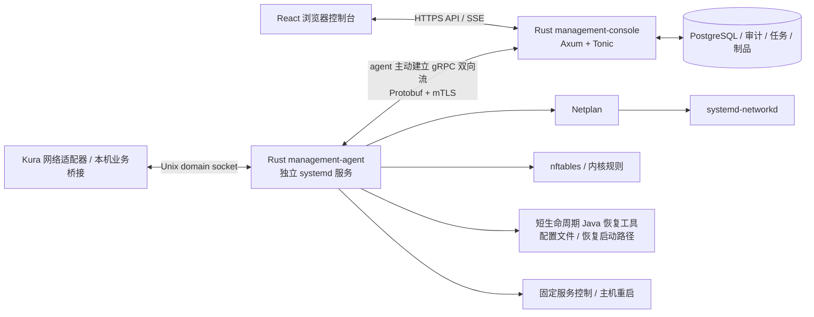

# YOFC Kura 管理体系完整改造方案

2026-11-01 当前最新配置增量：受限typed远程update与中英文React编辑器已接通，默认关闭、审核PID显式开放。
中心/agent持久去重、加密、权限和UNKNOWN挡写已接线，IDEA真实双语写入与Linux远程写/重启有独立证据，
见 `phase2-configuration-update-validation-20261101.md` 和 `configuration-remote-update-v1.md`。
本轮完成后按用户要求暂停目标；通用配置适用性、snapshot、配置UNKNOWN业务核定和阶段2–5仍未完成。
下列各增量的pending按各自日期/范围保留历史语义；当前续接台账为 `management-redesign-handoff-20261101.md`。

2026-11-01 配置基础增量：核心条件更新/opaque revision、密码保持与不确定失败挡写、Java内部handler已实施，
真实IDEA/Linux CM/DS/快照写入26项与重启恢复12项通过，见 `phase2-configuration-revision-validation-20261101.md`。
Protobuf/agent/中心/React的远程update接线仍pending，当前不登记写方法，不能称配置写入闭环完成。

2026-11-01 网络结果核定增量：网络 UNKNOWN 已能按认证原计划及绑定的业务终态核定，并有
原子加密回执、一次审计和双语说明。宿主/浏览器/IDEA 与 Linux 真实回执损失注入证据见
`phase2-network-outcome-validation-20261101.md`。仅替代前述对应 pending；旧无标记历史、
RECOVERY_REQUIRED、配置/快照写入及阶段2–5仍开放，不能扩大为硬断电或完整网络发行验收。

2026-11-01 后续存储增量：中心任务 input/result 已实施独立文件密钥加密、旧数据原子迁移及密文完整性检查，
见 `task-payload-storage-v1.md`、`phase2-task-storage-validation-20261101.md`。只替代前述相应未实施状态；
UNKNOWN业务对账、旧介质/agent历史、key轮换和阶段2–5仍未完成。

2026-11-01 执行日志增量：执行前持久化、UNKNOWN 查询、agent 新计划/回执加密、断流执行隔离、
双语迟到回执及新版 agent 包维护防护已有代码与证据，见 `phase2-task-journal-validation-20261101.md`。
中心敏感存储、真实未知写动作的业务对账、配置写入和阶段2–5仍未完成。

日期：2026-10-31。方案范围按用户确认统一。2026-11-01 实施状态补记：Rust/React 独立只读闭环和受限网络事务原型已有实际代码；阶段 2–5 尚未完成。当前实现与证据以 `phase1-validation-20261101.md`、`phase2-validation-20261101.md` 为准。本文其余“本次/当前基线”描述保留 2026-10-31 方案制定时语义，不能用作后续代码状态。

后续已实施单一明确 networkd 来源的转交和恢复，新增证据见 `phase2-takeover-validation-20261101.md`；完整阶段 2 及后续阶段仍开放。

2026-11-01 后续进展：React console 已实现简体中文和英文，含即时切换、选择保留及业务错误本地化，
见 `console-i18n-20261101.md`。用户提供的 Ubuntu 26.04 ARM64 Parallels 已完成受限只读验证，
多 VM 测试采用一台 Parallels（2 vCPU / 4 GiB）配合现有 OrbStack；环境和兼容修正证据见
`phase2-parallels-validation-20261101.md`。这不扩大为阶段 2 或发行验收。

同日新增核心 `ExternalConfigurationHandler`、确认值快照协调、Java 双向 UDS 服务和 Rust
有界并发读写，实施与真实隔离容器证据见 `phase2-provider-coordination-20261101.md`。
synthetic PID 已验证三入口路由；实际 Kura 网络 provider、旧字段映射与最小权限仍待实施。

同日后续增量已交付旧网络 PID 的确认值/状态 provider、Kura 本机最小网络委托及显式事务服务，
并修复核心启动时读取外部 owner 的循环依赖。真实 IDEA/UDS 和 Linux synthetic 角色证据见
`phase2-netplan-adapter-validation-20261101.md`。原 UI/REST 的事务确认入口、完整旧字段写入映射、
Linux 完整 Kura 和正式发行 profile 仍 pending；前段未交付描述保留对应增量的历史语义。

同日新增 JDK-only 公共 `NetworkTransactionService` 和原 Kura REST 的五个附加事务端点，
真实隔离 IDEA/HTTP/Java→Rust UDS 检查 21 项通过，原控制台登录及运行集恢复已核对。
见 `phase2-network-rest-validation-20261101.md` 与 `network-transactions-rest-v1.md`。
实际 HTTP 写候选/确认未在宿主开放，原 GWT 交互、无损旧字段映射及阶段 2 完整验收仍 pending。

同日后续交付原 GWT 的受限网络事务编辑、明确确认/回退、跨会话只读观测和中英文提示。
可写范围内保留附加地址、路由 metric、IPv6 DNS 和隐藏配置；完整旧字段写入映射仍 pending。
最终 GWT 构建及服务端 62 项、实际 IDEA/GWT RPC 浏览器 4 项通过；写事务使用 test-only owner，
系统网络写入为 0。React 生产构建和默认浏览器 11 项也通过本轮回归。
见 `phase2-network-gwt-validation-20261101.md`；Linux 实际 Kura/agent 写入、正式发行 profile
及阶段 2 完整验收仍未完成。前段未交付描述保留对应增量的历史语义。

同日后续增加显式 none/netplan 开发运行变体（278/280 bundles），真实 Linux 低权限 Kura
经 Java UDS/Rust agent 完成 dummy 接口 MTU 准备、明确回退、确认提交和恢复基线。
原 GWT 修正 Netplan 空网关校验，完整构建/服务端 63 项通过；React 默认浏览器 11 项通过。
IDEA 和 Linux Kura 均已停止，临时委托/agent env 已恢复，数据保留。
见 `phase2-network-profile-validation-20261101.md`。正式 deb/profile、真实 NM/cloud-init 和
物理有线验收仍未完成；前段的 pending/deferred 保留相应历史增量语义。

本文件是当前方案的唯一主文档，替代此前保留 Spring Boot、MQTT、旧 JSON 命令信封及独立 Vue 项目的提案。
同日后续修正原 GWT 的 Netplan Ethernet 类型与双语终态倒计时；完整构建/65 项、React 浏览器 11 项、
新的独立 test-only IDEA/GWT 浏览器 4 项通过并已恢复。见 `phase2-network-ui-regression-20261101.md`。
这次没有追加 Linux 写入验收，正式包/profile 仍 pending。
`kura-networking/docs/rust-netplan-wired-plan.md` 改为本方案入口，不继续维护另一套估算。
本文区分目标设计、现有源码事实和本次目录调整，不以方案、历史测试或编译通过代替功能验收。

2026-11-01 配置只读增量：新增 typed configuration.get、单任务回执和双语配置浏览器，
密码脱敏、不导出默认值；18项Java、宿主及Linux各44项agent、默认浏览器15项，
IDEA/Linux真实get与双语浏览器及agent重连通过，见 `phase2-configuration-read-validation-20261101.md`。
新fixture已停服保留、gateway disabled；未更新正式deb，配置写入/快照及阶段2–5仍未完成。

## 1. 目标与范围

2026-11-01 发行入口增量：新增显式 `kura-core-netplan` / `kura-networking-netplan` deb，
低权限 JVM、独立数据归属与不自动接管网络的维护脚本；真实包经过受控 Ubuntu24.04 arm64
升级、普通卸载、重装、停止修正和 purge，数据保留及其他 owner 基线已核对。
见 `phase2-netplan-package-validation-20261101.md`。这只替代前述“正式包入口尚未实施”的部分状态；
agent 正式包/UID授权、此组合业务、完整沙箱、旧系统迁移与发行矩阵仍未完成，阶段 2–5 保持开放。

同日后续已交付独立观察模式 agent deb、显式 mTLS 身份导入和 Kura 实际 UID 授权，
真实包组合的只读业务、agent 重启后 Kura 自动重新注册、升级/remove/重装/purge已有证据，
见 `phase2-agent-package-validation-20261101.md`。首装激活死锁已修正，失败现场保留；
各步骤采用不同候选，不宣称最终revision5重做全链。此增量仅替代前段对应未实施状态，
可写发行权限、完整沙箱、旧系统迁移、发行矩阵及阶段2–5仍未完成。

核心目标是将网关系统管理从 Kura JVM/OSGi 的生命周期中独立出来。Kura 业务脚本、DP 或其他业务
启动异常时，已确认的网络、防火墙继续由系统维护，独立 agent 仍可提供远程管理和离线恢复。
这是故障隔离与职责拆分，不是在判定原 Kura 网络实现有缺陷。

| 项目 | 已确定的方案 |
| --- | --- |
| 管理中心项目 | 原 `kura-management-backend` 改名为 `kura-management-console`；包含服务端与 `frontend/` |
| 中心服务端 | Rust、Tokio、Axum、Tonic；PostgreSQL 保存正式业务状态 |
| 浏览器前端 | React + TypeScript + Vite，浏览器渲染；构建资源随中心发布，由中心同源提供 |
| 网关代理 | `kura-management-agent` 迁为 Rust；独立 systemd 服务，合并系统网络、防火墙与管理职责 |
| 浏览器与中心 | HTTPS/JSON API；状态、命令进度使用 SSE；文件使用受控上传下载接口 |
| 中心与 agent | agent 主动建立 gRPC 双向流，Protobuf、mTLS；本系统无需 MQTT broker |
| agent 与 Kura | 文件系统路径形式的 Unix domain stream socket，系统身份与方法授权 |
| 有线网络 | Ubuntu Server 24.04+；Netplan + systemd-networkd；首期仅管理物理有线网络 |
| 防火墙 | 第二阶段由 Rust 管理原生 nftables；Kura 保留原接口和管理入口 |
| 在线配置与快照 | Kura 本机桥接 bundle 直接调用 OSGi 服务，不依赖网页账号或 REST 角色 |
| 离线恢复 | Kura 停止或卡死时，独立上传、校验、备份、恢复、启动及核验 |
| 系统控制 | 固定 Kura unit 的状态/重启及主机重启，独立权限、任务和结果核验 |

中心管理多台网关，不安装到每台网关，也不合并到 agent 进程。
Kura 的 `kura-management-ui` 是原有本机 GWT 管理界面，继续保留，与这里改名的机群管理中心不同。
现有 Vue 的限制不作为换框架的技术结论；选择 React 是本次重做控制台的产品与工程决定。

本期不包含：无线/AP、蜂窝和 ModemManager GNSS，VLAN/bond/bridge/PPPoE/策略路由的创建管理，
IPv6 配置写入，LAN DHCP/DNS 服务器，高级威胁规则，复杂容器网络，任意远程终端、系统镜像恢复，
坏 DP 自动隔离，以及跨网关密钥/私钥迁移。已有但未接管的配置应保留并如实显示。

## 2. 现有基线与本次实际调整

### 2.1 源码基线

| 原项目 | 核对基线 | 现状与缺口 |
| --- | --- | --- |
| 原 backend | `1ca46851af05ff3150aec49a3a0b3853062e6406` | Java 17、Spring Boot 3.4.1、JPA/Flyway、PostgreSQL/H2、Paho MQTT |
| 原前端 | `cf8d9634c35d4c368b30a6cc15f335f62241ce90` | Vue 3、TypeScript、Vite、Ant Design Vue；网关、命令、配置、快照、网络、防火墙和心跳页面 |
| agent | `0fcde96d3762726094d9f312d049e56725842e3e` | 独立 Java main；MQTT 收发；配置/快照使用 Kura REST；部分网络/防火墙能力待补齐 |
| networking 调研 | `d9bc0190f1f3cb4dc90fc1f4ba4392851ed894e6` | NM provider、iptables、安装接管脚本及既有 Kura 兼容面；实施前重新核对 HEAD |

原 backend 的 `TokenService` 将 Bearer token 保存在内存，TTL 为 12 小时；
`AuditService.record()` 是占位实现，`DemoDataInitializer` 在所有 profile 下预置演示用户和数据。
新中心必须采用明确、受控的管理员初始化，不照搬隐式默认账号。
现有代码不能作为成熟授权、完整审计或高可用能力复用的证明。
原 `ConfigPanel.vue` 按字段类型选择基础控件；新版本需建立专用编辑器机制。

本次代码图谱按真实子仓库选择；关键 Java 源码核对了路径覆盖与元数据。
POM 存在新鲜度差异时直接读取当前文件。路径改名后重新索引新的 console，旧 backend 索引不得继续当作当前证据。

### 2.2 本次交付与后续实现分开

本次已将 backend 本地目录改名为 `kura-management-console`，原前端源码移至 `frontend/`，
保留 backend 主线、旧前端 Git 归档引用和工作空间外备份。前端不再是独立同级 Git 项目。
新增统一构建脚本，将现有前端构建资源打入现有 Java 服务端产物，支持页面路径刷新。
脚本、工作空间说明及本方案同步新名称，历史验收记录不改写。

当前运行代码仍为 Java + Vue + MQTT；本次没有将下述 Rust/React 功能实现或记为通过。
远端仓库命名冲突、历史合并策略及发布切换另有迁移记录；未直接覆盖已有前端远端。

## 3. 目标组件与目录



目标源码布局：

```text
kura-management-console/             # 一个中心仓库
  Cargo.toml                        # Rust workspace；实现阶段增加
  crates/console/                   # HTTP、认证、任务、gRPC、SSE
  crates/management-protocol/        # .proto、生成配置及 Rust 协议 crate
  frontend/                         # React + TypeScript；本次先迁入现有 Vue
  migrations/                       # Rust 版本的 PostgreSQL 数据迁移
  packaging/                        # 中心安装包、unit、配置和前端资源
  docs/
kura-management-agent/               # 独立网关仓库；后续原地迁为 Rust
  src/{transport,network,firewall,kura,recovery,system}/
  packaging/
kura-networking/                     # 保持 sibling 边界
  bundles/...netplan.../             # 新网络 provider / Rust 适配
  bundles/...management.bridge.../   # Kura 业务桥接，最终包名在阶段 0 固定
kura/                               # 核心 API 与最小必要恢复启动改造
```

协议 crate 只有一个来源：console 仓库发布带版本的 crate/.proto 制品；agent 绑定明确版本与校验信息。
本地联调用补丁映射或受控路径，正式发布不得依赖机器上的 `../` 路径。
首期不另建协议仓库，也不在两边各维护一份可独立修改的协议副本。

中心一个进程包含 HTTP 与 gRPC；建议先用两个可配置监听端点：浏览器 HTTPS `443`、
agent gRPC/mTLS `8443`。这样无需在原型阶段解决两套 TLS 客户端策略共用端口的问题。
网关只向中心发起连接，不要求中心主动连通网关的公网 IP，也不开放网关 HTTP 管理端口。
中心使用独立低权限系统用户；首期单实例 + PostgreSQL，不增加 Redis/MQTT 等常驻中间件。

## 4. React 前端与 HTTP 层

### 4.1 技术与功能模块

| 部分 | 选择或实现要求 |
| --- | --- |
| 基础 | React、TypeScript、Vite；路由与异步数据层采用独立、可测试的模块 |
| 管理组件 | Ant Design；统一表格、表单、权限提示、错误与异步任务表现 |
| 复杂数据 | 按实际需求使用分页和虚拟列表，不一次拉取全部网关、日志与历史 |
| 趋势与图表 | ECharts；历史查询与实时增量分离，避免每条心跳重画整个页面 |
| 脚本/XML/JSON | Monaco Editor；差异查看、大小限制、只读权限、敏感字段处理 |
| 拓扑与节点 | 预留 React Flow 扩展；基础依赖与一个状态展示入口可纳入重构，完整流程设计器另估 |
| 语言 | 保留现有中英文文案，协议错误码映射本地化说明 |
| 类型 | 浏览器使用版本化 HTTP/OpenAPI 生成类型；不把 gRPC 内部模型直接暴露成全部 Web API |

按功能组织 `features/gateways`、`commands`、`network`、`firewall`、`configuration`、
`snapshots`、`recovery`、`system`、`access`。组件不直接拼接网关内部文件路径或系统命令。

建立三类注册接口：页面/网关能力模块、配置编辑器、状态卡片。
普通 PID 用通用表单；特定 PID 或配置类型使用专用编辑器，可按 agent 能力和协议版本匹配。
网络配置提供接口/地址/路由/DNS 编辑和差异；防火墙提供规则编辑；恢复提供计划、敏感变更提示与结果。
不将所有未来功能塞进一个按字符串判断的巨大配置组件，也不支持服务端下发任意 JS 后执行。

### 4.2 部署、事件与安全

前端构建资源随中心版本打包，同源提供页面、`/api/v1` 与 `/api/v1/events`。
服务端仅对已定义的页面路由回退到 `index.html`；未知 API、制品和静态资源保持正确错误状态。
JS/CSS 使用内容哈希，入口页与敏感接口采用适当缓存策略；生产不运行 Node/Vite 开发服务器。

浏览器使用服务端会话，Cookie 设为 HttpOnly/Secure，选择适当 SameSite；修改操作统一 CSRF 防护和 Origin 校验。
不沿用当前把长期 Bearer token 放在 localStorage 的方式。登录限速、会话失效和密码散列纳入中心重写。
用户、租户、网关和具体操作在服务端逐项授权；页面隐藏按钮不构成授权。

SSE 仅负责中心向浏览器推送状态/任务进度；修改操作仍走 HTTPS 请求。
事件有 ID、目标、revision 与时间；重连提供游标，历史超出保留窗口时发送全量重同步提示。
每个浏览器连接有授权过滤、速率和缓冲上限，订阅时和权限变化后检查权限；慢客户端不能占满中心内存。
首期不引入 WebSocket；将来需要交互式终端等双向高频能力时另行设计，不扩大当前系统控制接口。

迁移按功能闭环进行：登录/网关清单 → 网关详情/实时状态 → 命令 → 在线配置/快照 → 网络/防火墙 → 离线恢复。
Vue 页面在 React 对应功能通过验收前作为基线保留，完成后移除 Vue/Pinia/旧路由及旧构建依赖。

## 5. Rust 中心职责与数据

Axum 处理浏览器 API、会话、制品和 SSE；Tonic 处理网关 gRPC；共享业务服务层和数据库事务。
Tokio 异步收发；密码散列、压缩和其他阻塞工作有独立、有界的执行容量。
数据库访问建议 SQLx + 显式 SQL 迁移；实施阶段固定兼容版本、Cargo.lock、Rust 工具链和 MSRV。

| 模块 | 必须交付 |
| --- | --- |
| 用户与授权 | 租户隔离、用户/角色/操作权限、目标网关范围、独立恢复权限 |
| 网关管理 | 注册、证书状态、能力/版本、连接归属、在线状态及历史，不把演示在线状态当作真实心跳 |
| 命令与事务 | 持久化请求、授权上下文、状态事件、有效期、去重、取消/过期规则与结果查询 |
| 任务分发 | 数据库 outbox/领取机制、限流、并发上限和按网关排队；不在 HTTP 请求里等待整个恢复完成 |
| 制品/快照 | 元数据、目标、哈希、格式/版本、受控磁盘内容、配额与保留策略 |
| 审计 | 操作者、网关、操作、请求/事务 ID、前后哈希、授权结果和执行结果；敏感内容脱敏 |
| 运维 | 健康/就绪、结构化日志、指标、配置检查、数据库与制品备份/恢复 |

PostgreSQL 为权威业务记录，制品内容首期可存在中心专用目录，数据库保存索引和校验信息。
数据库与制品备份需要一致性清单；不能只备份数据库就宣称快照可恢复。
agent 独立保存系统已确认配置和本地事务，不把中心数据库视为网络启动的必需依赖。

初期按单实例设计，同时保留 `connectionEpoch`、网关唯一活动会话与任务租约。
未来多实例时，已经建立的 gRPC 流固定在一个实例，仍需连接归属与跨实例任务路由；
不能因使用 gRPC 就假定任意实例能直接向任何网关发送消息。多中心 HA 不计入本次基础估算。

## 6. 中心与 agent：重新设计协议

旧 JSON 信封未成熟，不作为新协议的兼容约束；保留业务语义，重新定义版本化类型和执行状态。
gRPC 不负责替业务实现持久化、幂等、恢复或“恰好一次”。

### 6.1 连接、身份与消息

建议的概念 RPC：

```protobuf
rpc Connect(stream AgentFrame) returns (stream ConsoleFrame);
rpc UploadArtifact(stream ArtifactChunk) returns (ArtifactReceipt);
rpc DownloadArtifact(ArtifactRequest) returns (stream ArtifactChunk);
```

以上仅表达方向，不是已经冻结或实现的 `.proto`。agent 主动调用 `Connect`；
中心通过响应流下发命令，agent 通过请求流上报心跳、能力、回执和事件。
上传/下载由 agent 发起独立 RPC；浏览器上传到中心后，agent 按受权制品 ID 拉取。
大文件不塞进控制消息，限制分块、并发与速率；必要时使用独立连接，避免连接级流控影响心跳。

| 类别 | 主要内容 |
| --- | --- |
| 握手 | 协议主版本、agent/Kura/系统版本、boot ID、能力、当前 revision、恢复/事务状态 |
| 命令 | `commandId`、目标身份、`operation`、有类型负载、有效期、幂等键、`expectedRevision`、审计关联 |
| 回执 | 已接受、执行中、待确认、完成、失败、回退、过期或结果未知；附本地事务 ID 和事件序号 |
| 心跳 | agent 健康、Kura 状态、资源与连接信息；高频指标可独立限速，不携带秘密 |
| 制品 | 上传 ID、偏移/分块、总大小、内容哈希、目标版本、结果；请求不包含任意本机路径 |

Protobuf 使用有类型消息和 `oneof`，只在 Kura 扩展字段确实需要时使用受限动态值。
字段编号和枚举不复用，删除项 reserved；未知能力明确拒绝，协议不匹配在写入前失败。
命令状态、错误码、大小、超时、版本协商及黄金样例同时供 Rust、Java 与浏览器契约测试使用。

mTLS 每台网关独立证书，校验中心主机名/信任链与目标网关绑定；不信任负载自报 tenant/gateway。
首次注册使用限时、一次性且限定网关的引导凭据，审批后发证；支持轮换、吊销/禁用、到期前告警。
引导凭据与私钥不进入 URL、日志和普通命令结果。不跳过证书或主机名校验来解决部署问题。

2026-11-01 补充归属约束：console/agent 注册、证书及授权独立于 Kura 账号、
Web/REST 会话和 Kura 密钥库；Kura 停止不影响注册、心跳和主机管理。
每个 agent 只绑定一个逻辑管理中心；共享身份与归属存储的高可用实例属于同一中心。
已绑定网关在另一中心的普通登记不得自动抢占，须由原中心授权转移，或由有权限的
网关本机运维执行重新绑定。新中心审批不能单独解除旧归属，也不能仅凭 gatewayId
或 Kura 登录凭据取得控制权。

转移须在 agent 持久化新中心身份、信任材料和递增的绑定代次后生效；旧流、旧授权
及旧代次任务失效，重启不得自动回连旧中心。证书续期及同一中心重连保持现有归属，
连接 epoch 不能替代跨中心绑定代次。未决有副作用事务须先完成、回退或明确进入
人工恢复状态，不能将旧中心未决任务直接交给新中心。旧中心可保留历史，失联时按
心跳超时标离线；旧中心不可达不妨碍有权限的本机恢复，但不承诺同步删除其数据库记录。

2026-11-02 实施基础：center Gateway API 暴露 `bindingGeneration`，数据库持久化
`mgmt_gateways.binding_generation >= 1`；agent identity 持久化
`AGENT_BINDING_GENERATION=1`，pre-generation same-center identity 只能通过显式
`migrate-binding-generation` 补齐。缺失、变更或第二中心 import 仍会拒绝，普通注册不会
抢占归属。

同日新增有权限网关本机 rebind：`transfer-identity` 要求精确旧代次、operator 身份、无
RUNNING/UNKNOWN 副作用事务、无 writer 授权；验证新链/key 后备份旧 identity 和 receipt，
再将 `AGENT_BINDING_GENERATION` 递增。这不是自动抢占，也不是签名授权流程。签名引导、
外部审批和真正的跨中心 transfer 仍未实施；不能把本机 rebind 基础宣称完成完整转移验收。

### 6.2 重连与执行语义

中心先落盘命令，再交给连接任务；agent 在接受具有副作用的命令前落盘幂等记录和执行计划。
重连时交换会话 epoch、最后事件序号和未决任务，重复请求返回原结果，不重复重启或恢复。
网络、恢复、配置、服务控制分别定义超时；RPC/中心显示超时不等于底层动作已撤销。
无法证明最终状态时报告 `UNKNOWN/RECOVERY_REQUIRED` 并协调查询，不自动新建一次相同写操作。

离线队列只保存允许排队的操作，带有效期和容量限制；恢复、主机重启等危险动作不在数小时后自动补执行。
取消是业务请求，只有尚未执行或可安全补偿的阶段才可确认取消；不能把关闭 gRPC 流当作取消系统操作。
外部断网时，agent 本机网络和回退能力仍运行；它不会凭进程独立产生另一条远程通信链路。

读循环只分发消息；每台网关和各业务类别使用有界队列、超时和背压。
大量心跳、慢网关、文件上传和 Kura 卡死不能耗尽中心或 agent 的控制资源。
容量目标在阶段 0 记录为明确的网关数/心跳频率/并发命令/制品流量；验收记录 CPU、RSS、FD、延迟、
重连风暴与慢消费者，不预先宣称某个框架保证多少万连接。

## 7. Rust agent 与本机 Unix socket

一个常驻 `kura-management-agent.service`，内部区分远程传输、状态采集、系统网络、防火墙、
Kura 桥接、离线恢复和系统控制。短生命周期的受控命令/Java 工具可作为子进程，
但不另起第二套常驻网络 agent。

服务启动先完成事务恢复、本地 socket 和系统能力初始化，再异步连接中心。
不依赖 Kura、MQTT 或 `network-online.target`；不通过 `Requires/BindsTo/PartOf` 绑定 Kura 的生命周期。
重启 Kura 不重启 agent，停止 agent 不清空已确认的系统网络和内核规则。
Kura 调用与文件转换采用独立的有界执行资源；阻塞任务不在 Tokio 读循环中运行。

本地结构化任务、幂等及事务日志建议使用嵌入式 SQLite，配置/备份内容使用受控文件和哈希清单；
不增加数据库守护进程。SQLite 访问放入有界阻塞执行器，明确持久化设置和事务顺序。
数据库提交与文件替换没有跨存储原子性，仍按阶段日志补偿，不能用一条 SQL 事务代替文件恢复设计。

需要写系统配置和控制服务的模块具有明确系统权限。首期一个受限的特权 agent，
固定允许的程序、参数和路径，不开放任意命令执行；同进程模块分层不是特权隔离边界。
systemd hardening 按 Netplan/nft 实际工作方式验证，不机械启用会改变目标网络命名空间的配置。
独立 cgroup/资源限制降低 Kura 资源耗尽的影响，但不承诺隔离整机 OOM、磁盘故障或 root 破坏。

建议路径与权限：

| 路径 | 用途 |
| --- | --- |
| `/etc/kura-management-agent/` | 中心连接、身份引用和接管策略；秘密单独受保护 |
| `/run/kura-management-agent/control.sock` | 本机 Unix stream socket；目录 `root:kura-management 0750`、socket `0660` |
| `/var/lib/kura-management-agent/` | 已确认状态、事务、幂等记录、上传及恢复备份；不随 Kura 普通卸载删除 |
| `/etc/netplan/90-yofc-managed.yaml` | 仅明确接管的接口配置；不将有效主机配置作为可直接清除的普通包文件 |

UDS 采用“4 字节大端长度 + UTF-8 JSON”，保留本机易调试和 Java 原生接入；
与远程 Protobuf 分开编解码，共享方法语义和测试样例。初始单帧上限建议 1 MiB，实施按方法固定。
包含版本、kind、requestId、method、params/result、错误码，写入增加 revision 和幂等键。

Rust 作为 socket 服务端，Kura 客户端建立连接并登记可提供的 `kura.*` 方法；
同一连接支持双向请求、响应和事件，不能在等待响应时停止读取其他帧。
Linux 使用 `SO_PEERCRED` 核对用户；Java 21 使用 `UnixDomainSocketAddress`，
需要时用 `jdk.net` 的对端凭据能力校验服务身份，验证目标 JDK/平台支持；Java API 不提供对端 PID。

Unix socket 不监听 IP；外部机器不能经 IP 直接连此端点，但本机身份仍必须校验。
角色登记不能自行赋权；root、Kura、只读运维和恢复运维分别限定方法。
Kura 共享 JVM 身份，无法凭 socket 区分同 JVM 内的业务插件，故 Kura 身份不授予离线恢复/主机重启。
安装包设置用户、组、权限与方法策略，权限异常返回可诊断错误，不退回匿名 HTTP 或网页登录绕过。

## 8. Kura 接口、本机桥接与配置所有权

保留公共 Java 接口、网络配置 PID、字段、事件和既有网络/防火墙管理入口。
新 provider 仍在 `kura-networking`，公共 API 保持在核心；不恢复已删除的 GPIO、Command、Bluetooth 等模块。
`org.eclipse.kura.net.admin.NetworkConfigurationService` 在现有实现中是配置组件 PID，
不能误当作已有同名公共 Java 服务接口；`NetworkStatusService` 公共服务则继续实现。

本机桥接首批六项：配置列举/读取/更新、快照列举/保存/回滚。
直接调用 `ConfigurationService` 等 OSGi 服务，继续复用字段校验、加密、factory 和快照逻辑，
不为 agent 新建免登录 REST，不要求配置 Kura Web 用户/密码。
已有浏览器/外部 REST 继续原认证；本机能力失效返回 Kura 不可用，不转为停服恢复。

Kura 的网络/防火墙适配器调用 Rust；中心同样直接调用 Rust 的同一服务层。
单一写入者、同一 revision、事务锁和审计适用于两条入口，不存在 REST 超时后另走 Rust 重写一次的逻辑。

权威状态为 Rust 已确认配置；候选事务、系统运行值与 Kura 快照镜像分开。
networkd 按系统文件启动，Rust 读取确认状态与实际状态，Kura 后启动时同步 Rust。
`activate()`、首次 ConfigAdmin 回调和重连只读同步，不能重放旧快照配置。
同步前写入返回未就绪；运行时明确修改才创建事务，旧 revision 拒绝。
确认/回退后同步 Kura 镜像和原有事件，带来源防循环；事件丢失后允许全量重同步。

需要同时覆盖网络 REST、通用配置修改、显式 snapshot rollback 三条入口；
不能让通用 `config.put` 或恢复旧快照绕开网络事务。
现有快照会合并配置，不能仅靠 `getConfiguration()` 就假设候选值不会持久化。
协调优先在 networking 完成，确需核心改动时按最小范围单列评审和下游回归。
既有 REST 路径如 `/services/networkConfiguration/v1`、`/services/networkStatus/v1` 保持；
新增事务查询/确认/回退采用附加路径，区分请求接受与实际确认，不能用长 HTTP 等待替代事务。

## 9. 有线网络与变更事务

### 9.1 首期能力与系统改动

支持物理网卡枚举/MAC/carrier/MTU，IPv4 DHCP 客户端和静态地址、前缀、默认与基本静态路由、
metric、DNS 和搜索域；区分配置值与运行值。启停、自动连接及 MTU 逐项固定旧语义映射。
保留已有 IPv6、容器和未接管接口；不支持的字段组合整次拒绝，不静默忽略后报告成功。
DHCP 客户端不等于向 LAN 提供 DHCP/DNS 服务；本期不引入 bind/dnsmasq 服务器依赖。

首次安装只观测，不改变现有 IP/renderer，不自动停用 NM。
接管前读取 `/lib`、`/etc`、`/run` Netplan 合并结果与文件来源，盘点 cloud-init、设备匹配和其他写入者。
同一接口存在未知或多重写入来源、复杂拓扑时停止自动接管，输出计划与诊断。
不得删除所有 YAML 或假设新增一个高序号文件能正确替换列表等旧配置。

明确接管时保存原文件/权限/服务状态，归一受管接口，保留无关接口和未支持的 IPv6 策略。
每次变更核对文件哈希与 revision，外部漂移产生冲突。沿用系统 resolver，不直接覆盖 `/etc/resolv.conf`。
系统变更限于受管 Netplan 文件、agent/unit/私有状态；不修改网卡命名或 `/usr` 中的发行版配置。

### 9.2 状态机与确认

```text
PREPARED -> APPLYING -> WAIT_CONFIRM -> COMMITTED
                |             |
                +----> ROLLING_BACK -> ROLLED_BACK
                                      |-> RECOVERY_REQUIRED
```

1. 校验权限、能力、expectedRevision、接口归属、地址/路由冲突与并发操作。
2. 建立包含完整配置来源的 staging 根目录，使用目标版本支持的 `netplan generate --root-dir` 校验。
3. 在替换候选之前持久化原文件、最后确认状态、事务和未确认标记，固定文件/目录 fsync 顺序。
4. 原子替换受管文件并受控应用；子进程有限时，失败可能已产生部分系统改变，进入补偿。
5. 立即返回事务 ID；示例确认窗口 120 秒，以能力配置为准，中心任务等待时间与该窗口分开。
6. 受影响管理路径重新连通后发起新的确认；gRPC/本机 socket 曾经在线、发出消息或 ping 公网均不等于确认。
7. 确认后提交 revision、事件和 Kura 镜像；失败、超时或恢复时发现未确认事务，回退并回读核验。

管理目标按部署配置，离线网络可通过获权本地工具确认；不能把公共互联网连通作为通用条件。
`netplan try` 可作参考/辅助，但其回退需核验，不能替代持久化日志和重启恢复。
必须在 VM 验证未确认文件的早期恢复与 Netplan generator/networkd 启动排序；
仅写一个 `Before=` 不构成断电安全证明，不能恢复排序时需改变候选落盘策略。

一个系统变更协调器串行化网络、防火墙、离线恢复和主机重启等冲突动作，
不是串行化所有状态查询；不同子系统不具备跨系统原子提交，使用阶段日志和补偿。

## 10. 防火墙迁入 Rust

基础范围：开放端口、明确过滤策略、端口转发与基础 NAT，迁移旧 Kura 规则语义；
保留 Kura 防火墙 API/PID/页面，底层由 Rust 管理 nftables，内核执行包过滤。
原实现已有系统启动规则恢复，本次统一执行、持久化与写入所有权，不宣称从前规则仅存在 JVM 内存中。

使用自有表/链，例如 `inet yofc_kura`，不执行全局 `flush ruleset`。
完整生成候选，`nft` 检查后批量事务更新，避免先清空再逐条重建；回读并记录已确认规则。
显式映射 IPv4/IPv6，不因使用 `inet` 就把 IPv4 开放策略复制到 IPv6。
base chain hook/priority/drop 语义必须验证，一张表中的 accept 不保证覆盖其他表的 drop。

UFW 是管理前端，iptables-nft 是兼容接口，原生 nft 是本方案执行接口；不同时维护两套权威规则。
检测 UFW、firewalld、旧 Kura、防火墙恢复服务及 Docker 等活动写入者，未确定接管策略就只观测。
Ubuntu 文档不建议原生 nftables 与 UFW/iptables-nft 混用，独立表不能作为安全共存保证。
复杂 Docker/NAT 环境另行选择后端、所有权和流量验收，不纳入自动接管承诺。

旧 Java 规则写入、旧恢复脚本与高级威胁模块必须退出已接管范围，不能残留隐形双写。
不覆盖未核对的 `/etc/nftables.conf`，不无条件启用系统 nftables 服务；早期恢复只加载自有确认规则。
网络与防火墙共用确认/回退框架；管理入口按部署配置，不固定永久开放 22/443，也区分字段缺失与明确关闭。
仅防火墙安装模式继续存在，不能因安装该模式自动启用网络接管。

## 11. 系统控制与离线恢复

### 11.1 服务与主机操作

`service.status`、`service.restart` 只接受安装时固定映射的 Kura unit；
`system.reboot` 使用专门权限、明确确认和持久化任务。请求不包含任意 unit、shell 或参数。
Kura 卡死时由 systemd 在该 unit/cgroup 范围内限时停服，禁止 `killall java` 等无差别处理。
重启回执区分已接受、进程/主机重启、应用恢复；结合 boot ID、恢复 ID、桥接和业务健康报告结果。
断线不算成功；命令重放不连续重启，待确认网络事务未解决时拒绝或明确回退后才允许重启主机。

### 11.2 离线的定义与范围

离线指 Kura/JVM/OSGi/桥接不可用，agent 和操作系统仍可工作。
远程路径为浏览器 → 中心 → gRPC → agent，不需要故障 Kura 的 Web 账号或配置服务。
中心不可达时可由获权本地工具访问同一服务；本机网络完全断开时仍需本地接入或预置回退。

首批支持本机、兼容 Kura/快照版本与实际密钥的完整快照上传、磁盘历史快照恢复；
随后支持基于一个已验证完整快照的指定 PID/字段修正，生成新的完整恢复快照。
明确完整替换、保留与删除语义；原先损坏的 DP/脚本/插件代码不因快照恢复而必然修复。

单列 `kura.offline-recovery` 权限，中心核对操作者和目标，agent 核对可信来源、目标、操作、有效期和去重。
不使用 `superuser=true` 字段赋权；普通网络或 Kura socket 身份无此权限。
上传配置可能包含可执行脚本，应按高权限配置发布处理，差异页明确显示这类变更。
在线调用超时绝不自动转成停服覆盖。

### 11.3 复用格式与核心改动

Rust 负责授权、停启、事务和文件；短生命周期 Java 恢复工具复用/抽取 Kura XML、类型及加密逻辑，
不启动 OSGi 和业务包、不执行上传脚本/类，不在 Rust 中另写一套 Kura 格式。
工具能否无容器抽取、依赖和固定版本在原型验证，已经计入工作量。

| 已核对源码行为 | 必须处理 |
| --- | --- |
| `ConfigurationServiceImpl` 按最大快照 ID 选择 | 恢复时生成大于现有有效 ID 的新编号，记录来源映射并处理溢出 |
| 可按 `kura.snapshots.encrypt` 整体加密；字段密码也可能独立加密 | 按真实模式与密钥校验，不把任意 XML 当作可加载快照 |
| `CryptoServiceImpl` 支持 credential、系统属性、环境及默认回退 | 使用该部署真实密钥，不假定每机同密钥或必不同；首期不轮换/覆盖原密钥 |
| 启动会合并 ConfigAdmin/组件配置与快照 | 增加受控恢复启动路径，明确旧配置及 factory 实例删除/覆盖，不能只复制 XML |
| 加载失败可能回退旧快照 | 核对实际恢复 ID/哈希，不能仅凭进程 active 判成功 |

恢复工具有自己的受控凭据来源，与 Kura 校验一致；不能依赖停服后消失的运行期 credential 文件。
密钥不经命令行、gRPC 回执或日志泄露。完整恢复保留本机密钥/证书/用户数据，
不直接编辑 ConfigAdmin 内部存储格式，也不清空 framework/整个数据目录。

最小核心改动在受影响业务配置激活前，按恢复清单处理目标并记录应用结果。
完整恢复处理目标中不存在的受管 factory 实例，字段修正只改列出项。
网络和防火墙 PID 从 Rust 当前 revision 同步；恢复旧 Kura 快照不能回滚已确认系统网络。

### 11.4 恢复事务与中断

```text
STAGED -> VALIDATED -> STOPPING -> BACKED_UP -> COMMITTING -> STARTING -> VERIFYING -> SUCCEEDED
                                      |          |              |
                                      +------> COMPENSATING -----> FAILED / RECOVERY_REQUIRED
```

1. 分块暂存、总量/数量/磁盘配额限制；安全解析，拒绝 XML 外部实体、路径穿越及符号链接逃逸。
2. 校验目标、格式、版本、密钥和哈希，生成恢复计划、差异、验证条件及限次失败策略。
3. 持久化意图，协调系统变更与包升级，阻止新在线写入；按固定 unit 停服并确认相关写入进程退出。
4. 无法确认独占则不覆盖；停服后重新核对基础哈希/revision，漂移时重新准备。
5. 备份必要快照、配置持久化资料与恢复状态到 agent 私有目录，记录权限/所有者/文件清单，保留密钥和用户数据。
6. 在目标文件系统内准备完整候选，持久化日志/文件/目录，以原子重命名发布并写恢复清单。
   多文件按日志补偿，不声称整个恢复靠一次 rename 原子化。
7. 启动后检查真实恢复 ID、哈希、配置应用结果、桥接/控制台和选定业务条件，分别报告证据。
8. 失败限次补偿；原状态本就可能卡死，回退只表示撤销修改。仍失败可保持 Kura 停止并让 agent 继续可管理，避免无限重启。

agent 崩溃或主机重启后，恢复检查在普通 Kura 启动前处理未完成事务；
无恢复事务时不要求中心在线或常驻 agent 成为 Kura 启动硬依赖。
上传中断、磁盘满、停服超时、外部启动器重新拉起、部分提交和业务再次卡死分别验收。

## 12. 发行、依赖、数据与升级迁移

Ubuntu 24.04 LTS 与 26.04 LTS、amd64 与 arm64 分别建立包和运行矩阵。
Rust 以最低支持的 Ubuntu 用户空间构建，核对 glibc/动态库/系统工具能力；
不因在更新系统编译成功就认定 24.04 可运行。未来版本逐版验收，不承诺天然兼容。

| 发行角色 | 边界 |
| --- | --- |
| 中心 console | Rust 可执行程序、React 静态资源、配置/unit、数据迁移；生产不再需要 Java/Spring/MQTT |
| 网关 agent | 独立程序、unit、身份/状态、恢复工具及早期恢复步骤；无 Kura 也可维护系统能力 |
| Kura 有线网络适配 | 新 provider/桥接和依赖，替换旧 NM 实现，不能同时激活同 PID 的两套 provider |
| Kura 仅防火墙 | 保留安装选择，启用 Rust 防火墙能力但不接管网卡 |

去掉 Kura 自身的 Java D-Bus/NM 依赖需要检查：NM bundle 和内嵌库、ModemManager GNSS provider、
Maven/DP/开发运行集、networking deb，以及核心 deb 中残留的 NetworkManager/ModemManager 依赖、
服务绑定和旧权限脚本。只替换一个写调用或一个 deb 控制文件不足以完成清理。
不要误删其他消费者使用的 JNA/ASM 等库。

目标是本方案不直接使用 Java/Rust D-Bus 客户端、不因安装 Kura 拉入 NM；
不是卸载 Ubuntu 的系统 D-Bus。系统工具/服务可能仍使用系统 IPC，保留其原有布局。
旧 NM/wpa/蜂窝变体如继续支持需独立发行选择，不将不受支持能力偷偷保留为运行依赖。

安装/卸载规则：

- 首次安装只读观测；升级保留网关身份、中心地址、最后确认状态、事务、快照、密钥与证书。
- 普通卸载停止/移除程序，但保留用户配置、快照、密钥、证书、恢复备份和有效系统网络，不恢复出厂 IP。
- 重装读取原状态、校验兼容性并接续，不生成新身份或重复执行旧命令。
- purge 仅清理该包明确拥有且列入清理范围的数据；agent purge 不顺手删除 Kura/其他包的数据。
  当前有效网络/防火墙须先交接给系统并验证，不能删除配置后等待下次开机失联。
- 拟定最终包名、文件归属、Conflicts/Depends 和切换顺序，验证 full-network 与 firewall-only 不意外卸载所需组件。

老 NM 网关自动迁移不放进 postinst。拿到镜像/配置样本后盘点 renderer、活动连接、IP、路由、DNS、
cloud-init，生成等价配置、预置回退并显式确认；不可靠就保持原网络并提供人工步骤。

Java/MQTT 向 Rust/gRPC 切换时先部署中心新服务端、注册证书和验证只读连接，再切 agent 与 Kura provider。
同一网关不得同时运行两套有写权限的 agent/provider。过渡 MQTT 服务只为尚未迁移网关保留，
新协议不兼容旧信封；迁移完成才移除 broker 和旧代码。批次登记已切换网关，失败按明确回退计划处理。

中心数据库保留 tenant/gateway/用户标识和必要历史，提供有版本的迁移与核对工具。
现有 BCrypt 密码先采用兼容验证/登录后升级，避免批量强制换密码；内存 token 不迁移，用户重新登录。
生产 Postgres 迁移先备份演练，不把 H2 演示库当作生产数据来源；快照记录不等于已有完整快照文件备份。

## 13. 实施顺序与交付门槛

| 阶段 | 交付 | 进入下一阶段条件 |
| --- | --- | --- |
| 0：基线与契约 | 仓库整合、目标镜像/字段/包清单、协议、容量目标、原型和可重复构建 | 范围冻结，回退资料和协议样例可评审 |
| 1：独立管理闭环 | Rust 中心/agent、mTLS 注册、只读状态、UDS、React 登录/网关/命令骨架 | Kura 停止时仍心跳和查询，断线重连/越权/限流测试通过 |
| 2：有线网络 | Netplan、配置事务、Kura provider、镜像/快照协调、React 有线编辑 | 断线自动回退、重启中断恢复、旧 Kura 启动不覆盖系统网络 |
| 3：防火墙与系统控制 | nftables、仅防火墙选择、固定服务/主机操作 | 单一写入权、真实流量/回退及重复重启防护通过 |
| 4：离线恢复 | 完整快照、字段修正、Java 工具及核心恢复启动路径 | 卡死 Kura 下恢复及每个中断点可证明，无数据误删 |
| 5：发布迁移 | 双架构/双系统包、数据/身份迁移、批次切换、回归和运维手册 | IDEA、控制台、Linux 包生命周期和故障报告完整 |

前端、中心授权、审计和打包贯穿各阶段，不能集中留到所有系统写功能做完后。
先交付受控系统原型，再逐步放开写权限。原型不等于生产可安装版本。
具体 Rust/JS 版本在阶段 0 以兼容矩阵和依赖审计锁定，不在方案中虚构一组未经构建的最新版本。

## 14. 全范围工作量重新估算

按熟悉当前 Kura/OSGi、Rust、Linux 网络与前端的工程师计人日，每周五个工作日。
包含实现、该工作项单元/契约验证和评审修正；最终集成行只计跨模块/系统验证，不重复相加同一测试。
基于干净或明确可控的 networkd 系统、单中心实例与基础 nftables，不是固定报价或交付日期承诺。

| 编号 | 工作项 | 人日 |
| --- | --- | ---: |
| A | 字段/镜像/包基线、仓库工具整合、协议与故障原型 | 5–7 |
| B | Rust 中心 HTTP、PostgreSQL、会话、租户/操作授权、审计 | 12–18 |
| C | gRPC/Protobuf、mTLS 注册/轮换/禁用、重连与制品传输 | 9–14 |
| D | 中心持久任务、outbox/状态、网关在线与 SSE | 6–9 |
| E | Rust agent 常驻服务、身份/状态、幂等日志和执行隔离 | 6–9 |
| F | UDS 协议/Java 客户端、鉴权、六项 Kura 业务桥接 | 7–10 |
| G | 有线状态/模型、Netplan DHCP/静态地址/路由/DNS 后端 | 5–8 |
| H | 网络确认、回退、漂移冲突、早期恢复及中断状态机 | 6–9 |
| I | Kura provider、PID/REST/事件/快照协调、NM/D-Bus 依赖清理 | 6–9 |
| J | 基础 nftables 过滤/NAT/转发迁移、持久化与回退 | 8–12 |
| K | 完整快照离线恢复、Java 工具、核心恢复启动和事务 | 8–12 |
| L | 离线指定 PID/字段修正、差异、敏感值与保留/删除语义 | 4–7 |
| M | 固定服务状态/重启、主机重启和结果核验 | 2–3 |
| N | React 全部现有页面迁移、模块/编辑器扩展、新网络/恢复流程 | 18–27 |
| O | 中心/agent 发布包、双架构、生命周期、现有数据/身份切换 | 6–9 |
| P | 全链路回归、IDEA/控制台、Linux 矩阵、容量与故障验收 | 9–14 |
| **基础总量** | **上述完整范围 A–P** | **117–177** |
| **约 20% 联调/差异缓冲后** | **向上取整** | **141–213** |

此前 74–110 人日包含网关侧有线、防火墙、离线恢复及服务控制的估算与缓冲，
不包含中心 Rust 重写、协议全面改造及 React 控制台重写，不能继续当作本次总量。
本表重新拆分，已经包含其网关工作，不再叠加旧估算。
网络/防火墙共用事务、恢复/重启共用服务控制、两端共用协议契约，均不重复计费。
本次实际目录调整属于 A 的已完成部分，不在后续再次完整重做；开始实施时按实际完成项扣减并复估。

| 投入方式 | 日历量级，仅供排期 |
| --- | --- |
| 一人承担全栈 | 含缓冲约 29–43 个工作周，约 7–10 个月 |
| 两人：Rust/系统与中心/前端并行，具备 Java/OSGi 支持 | 约 17–26 周，约 4–6 个月；依赖契约、集成和验收无法简单除二 |
| 受控原型 | 约 12–18 人日，包含在 A–P 中，不是额外追加，也不能替代完整交付 |

原型目标是串通 Rust 中心/agent、UDS、一个 React 状态页和一项受控 Netplan 事务；
不要求一次完成所有认证界面、发行包和恢复功能。阶段 0/1 后按实际吞吐和兼容问题复估剩余工作。

另行估算的扩展：很旧 NM 镜像迁移工具约 5–10 人日，前提是先有真实样本；
完整可视化流程设计器约 10–20 人日，取决于保存/校验/运行模型；
无线/蜂窝、复杂容器防火墙、HA 多中心、DP 隔离、跨机密钥迁移及系统镜像恢复待专项范围确认。
这些项目既未计入基础总量，也未用“未来可扩展”代替实现承诺。

## 15. 验证矩阵与完成标准

先做协议/状态机/模型的 Rust、Java 和前端测试，再验证 IDEA 完整 Kura 启动、
原控制台登录及配置/快照/网络相关单元测试；新 React 控制台同时做登录和关键流程浏览器测试。
上述开发运行验证通过后，才进入 OrbStack 真实 Linux 安装与故障测试。

| 范围 | 关键证据 |
| --- | --- |
| 协议与身份 | 跨租户/网关越权、证书过期/轮换/禁用、未知版本、伪造能力、超大帧、断线重复回执 |
| 多连接与事件 | 明确容量目标下的连接/FD/RSS/延迟、重连风暴、慢消费者、文件并发与队列限流 |
| Kura 故障隔离 | Kura 停止、启动卡住、脚本/DP 异常时 agent 在线，网络/防火墙/系统控制可独立操作 |
| Kura 桥接 | 六项业务方法；Web 密码/角色变更无影响；桥接超时不阻塞系统能力，不自动离线恢复 |
| 配置一致性 | Kura 重启/旧快照/通用配置入口、revision 冲突、事件丢失和镜像循环均不覆盖确认网络 |
| 有线网络 | DHCP/静态地址、路由/DNS/MTU、非法组合、外部漂移、多接口，管理路径确认与超时回退 |
| 中断恢复 | 写候选前后、应用中、待确认、恢复备份/提交/启动中崩溃和主机重启，逐点有持久化结果 |
| 防火墙 | 实际流量、过滤/NAT/转发、IPv6 边界、管理入口、无全局清空、其他写入者冲突拒绝 |
| 离线恢复 | 明/密文、密钥不符、损坏 XML、factory 删除/保留、ConfigAdmin 优先级、实际恢复 ID/哈希 |
| 失败路径 | 上传中断、配额/磁盘满、停服超时、重新拉起、符号链接、回退后仍卡死、无无限重启 |
| 系统控制 | 重复/过期任务不重复重启，unit/cgroup 范围固定，boot ID 与真实业务恢复分别证明 |
| 发布矩阵 | Ubuntu 24.04/26.04 × amd64/arm64，按可用环境逐格记录；缺失环境标 deferred |
| 安装组合 | 核心 + agent、本机桥接、有线模式、仅防火墙、相关 sibling/YOFC，以及明确支持的切换路径 |
| 包生命周期 | 首装、升级、普通卸载、重装、purge；快照/密钥/用户数据按范围保留或清理，重启仍有网络 |
| 依赖产物 | 检查实际 jar/deb/DP/开发运行集和 apt 模拟，新变体不加载 NM bundle 或被核心依赖拉入 NM |
| 数据迁移 | PostgreSQL 用户/网关/历史与制品校验，身份不变、token 重新登录、批次切换/回退可追踪 |

OrbStack 验证服务、真实 Linux CLI、包生命周期和可控故障；有线拔插、驱动与硬断电仍需物理硬件证据。
不把 macOS mock、VM 正常重启或历史通过记录当成这些硬件边界的替代。
没有真实环境的矩阵项明确保留 deferred，不能记作通过，也不在本次整理方案时执行生产网络切换。

## 16. 主要实施风险与待冻结参数

1. Netplan 多来源与启动 generator 排序；候选/确认配置和系统启动必须形成可证明的恢复链。
2. Kura 快照、ConfigAdmin 和 factory 的真实优先级；离线恢复需要最小核心改造，不能承诺复制文件即可。
3. Kura 内桥接共享 JVM；进程故障隔离依赖有界执行与无启动等待，不是换语言自动得到。
4. 旧 iptables/UFW/Docker 管理权；样本和兼容策略未确定前拒绝自动接管。
5. 现有账号/数据迁移与证书发放；须演练升级、禁用和失效恢复，避免依赖人为配置所有 Kura Web 账号。
6. 2026-10-31 迁入的 Vue 基线 `npm ci` 报告 15 个依赖审计问题（3 moderate、12 high），
   现有产物还有大 chunk 提示。此为迁移前现状，不能作为新 React 发布基线；阶段 0 核对影响链，
   React 选型锁版本、依赖审计和页面拆包计入 A/N/P，不在本次直接执行破坏性自动升级。

阶段 0 冻结：网关数/心跳/并发/制品规模，正式镜像与包清单，现有 PID/字段映射，
权限矩阵、证书引导流程、最低工具版本、事务超时、快照格式和密钥来源、实际迁移样本。
细节冻结后可形成可交付的阶段排期；当前人日区间保留未知环境和跨模块联调的诚实余量。

## 17. 官方资料与复核原则

2026-10-31 对照官方框架/协议/系统文档核对设计；实施同时以目标 Ubuntu 安装包版本和 manpage 为准，
不直接将 latest 文档中的新能力视为 24.04 可用。以下资料供复查，不表示相关实现已经通过验证。

- Axum：<https://docs.rs/axum/latest/axum/>
- Tonic：<https://docs.rs/tonic/latest/tonic/>
- gRPC 流控：<https://grpc.io/docs/guides/flow-control/>
- React 构建基础：<https://react.dev/learn/build-a-react-app-from-scratch>
- Netplan generate：<https://netplan.readthedocs.io/en/stable/netplan-generate/>
- Netplan try：<https://netplan.readthedocs.io/en/stable/netplan-try/>
- Ubuntu nftables：<https://documentation.ubuntu.com/security/security-features/network/firewall/nftables/>
- Linux Unix socket：<https://man7.org/linux/man-pages/man7/unix.7.html>
- Java 21 对端凭据：<https://docs.oracle.com/en/java/javase/21/docs/api/jdk.net/jdk/net/ExtendedSocketOptions.html>
- systemd unit：<https://www.freedesktop.org/software/systemd/man/latest/systemd.unit.html>
- OWASP 授权：<https://cheatsheetseries.owasp.org/cheatsheets/Authorization_Cheat_Sheet.html>
