# YOFC 管理改造操作手册（中心 + 网关代理 + Web 控制台 + NM 联合事务）

截图轮次：2026-11-09，中心 `yofc-management-console 0.1.0`（debug 构建，phase1-dev 独立栈）、网关代理 `yofc-management-agent 0.1.0`（release v31，ELF `9aec838b…`，111 源码 pin 配对）。全部截图来自当日真实实例（Mac phase1-dev 中心 + Parallels Ubuntu 真实 NM 网关 + 两台 OrbStack VM 网关），非摆拍。

手册覆盖五部分：**安装与首次登录**（§1–§2）、**接入多台网关**（§3，含 Web 身份包流程）、**设置页：证书与任务密钥**（§3A，2026-11-10 新增）、**NM 联合网络事务**（§4，含全部截图）、**防火墙事务与任务记录**（§5–§6）。§7 为排障速查。

2026-11-10 增量（方案 A P1 + P2 轮换）：设置页上线（服务器证书 / 客户端 CA / 任务数据密钥备份·恢复·**轮换**，重启生效）；登记网关新增**一次性身份包**模式；网关代理新增 `kura-agent-setup import-bundle` 一条命令导入；网关详情新增**客户端证书轮换**（中心登记新指纹 + 一次性轮换包，网关 `kura-agent-setup rotate-bundle` 消费）。全流程可在浏览器完成，命令行仅保留为后备。另提供 **CSR 模式**（2026-11-11）：网关本地生成密钥与 CSR，**私钥不出网关**。

约定：

- 中心认证、网关注册完全独立于 Kura Web 账号；Kura 停止不影响中心/代理/控制台。
- NM 联合事务要求网关 NetworkManager ≥ 1.44（version-id CAS）、网卡为真实以太网（veth 虚拟网卡不支持，见 §7）、profile 已持久化（Flags=0 且 Unsaved=false）。

---

## 1. 中心安装与启动（phase1 开发栈示例）

```console
# scripts/phase1-dev.py up   # 起 PostgreSQL + console + 本地 agent
{"url": "https://localhost:39443", "username": "admin", "passwordFile": ".phase1-dev/admin.password", ...}
```

生产部署（docker 或 deb）见 `docs/manual/operations-manual-zh.md` §1–§2。空库初始化按产品要求提供 **admin/admin**，首次登录强制改密。

## 2. 首次登录与强制改密

打开中心 HTTPS 地址，语言可随时切换：


输入初始账号 admin / admin：

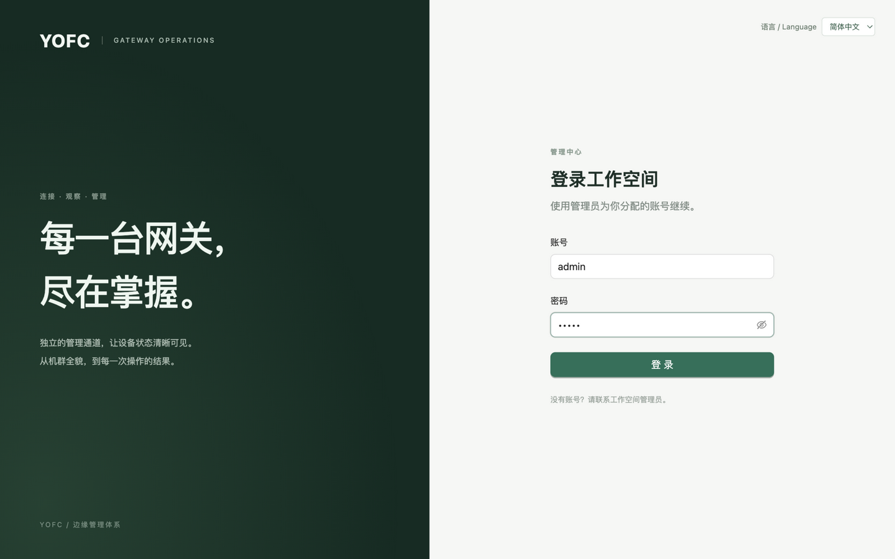

登录成功后强制设置新密码（至少 12 字符），服务端在此之前拒绝其他管理 API：


设置成功直接进入控制台，原 admin 密码失效。

## 3. 接入多台网关

**推荐路径（2026-11-10 起，全浏览器零命令行）**：

1. 中心控制台点 **登记网关**，选择 **「上传证书与私钥（中心下发一次性身份包）」**，填写网关 ID/名称并粘贴网关证书与私钥 PEM（证书可由 `tls-gen.sh <网关ID>` 预生成），核对指纹后确认登记。
2. 登记成功后页面出现**一次性身份包下载**：填入网关侧连接中心的地址（`https://<中心IP>:18444`），点击下载得到 `<网关ID>-identity-bundle.tar`。**下载即失效**；私钥仅此一次可下载，遗失须吊销网关重新登记。

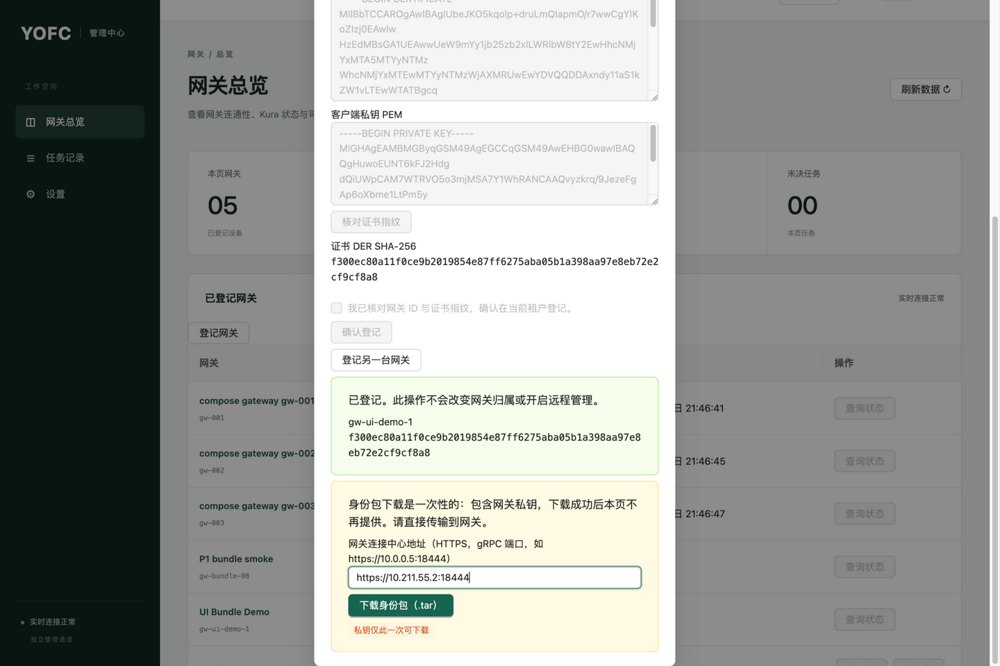

3. 网关安装代理 deb 后一条命令导入并激活（**入口是 `kura-agent-setup`**；`/usr/lib/.../setup.py` 无执行位）：

```console
sudo kura-agent-setup import-bundle /tmp/<网关ID>-identity-bundle.tar
sudo kura-agent-setup activate
```

`import-bundle` 校验包内 manifest 指纹链（ca.pem/agent.pem 与 manifest 一致）与证书/私钥配对后写入 `/etc/kura-management-agent/`（0600）并渲染 agent.env。失败即拒绝并保留现场，无 force 选项。

4. 开启远程管理通道（**持久决策，不看 env**）：deb 装完即以本地模式启动并持久化 `remote-management.json`（enabled=false），此后修改 `AGENT_REMOTE_ENABLED=1` 不生效。通过本地控制 socket 显式开启：

```console
sudo python3 remote-enable-uds.py   # remote.status 取 revision → remote.set-enabled enabled=true
```

2026-11-10 真实 VM 实测：OrbStack Ubuntu 24.04 arm64 全流程（UI 登记 → 下载包 → `kura-agent-setup import-bundle` → UDS 开启远程 → `activate`）后，中心总览显示在线（真实 mTLS 心跳），`查询状态` 任务 SUCCEEDED：

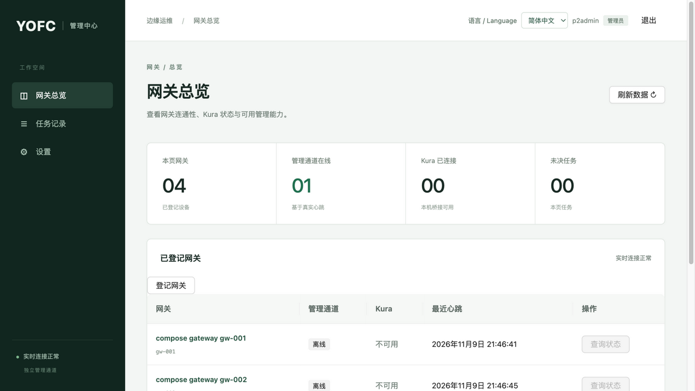

**后备路径（保留）**：网关侧 `kura-agent-setup import-identity --endpoint … --ca/--cert/--key` 四文件手工导入；中心侧 CLI `register-gateway`（不打包私钥）。装 Kura 的网关继续走原 GWT 身份交付流程（私钥不出网关）。

**CSR 模式（私钥不出网关，2026-11-11 新增，面向独立 agent）**：

```console
# 1. 网关本地生成密钥 + CSR（密钥保存在网关 STATE，仅 CSR 输出）
sudo kura-agent-setup create-certificate-request --gateway <网关ID> /tmp/<网关ID>.csr
# 2. 管理员将 CSR 交给外部 CA 签发（或自有 CA 流程），得到客户端证书
# 3. 中心「登记网关」→ 选择「仅粘贴证书（私钥留在网关）」登记该证书
# 4. 网关激活绑定（校验公钥配对与 CA 链后写入身份）
sudo kura-agent-setup activate-pending-certificate   --endpoint https://<中心IP>:18444 --ca /tmp/ca.pem --cert /tmp/<网关ID>.pem
```

待绑定期间密钥保存在 `/var/lib/kura-management-agent/certificate-requests/`（0700/0600）；同一时间仅允许一个待定请求。已装身份时拒绝新建 CSR（轮换走 §3A.1）。

NM 联合事务需在 agent env 追加：

```
AGENT_NM_CONFIG=/etc/kura-management-agent/nm-config.json   # {"schemaVersion":1,"interfaces":["eth0"],"writeEnabled":true}
AGENT_NM_REMOTE=1
AGENT_FIREWALL_REMOTE=1
AGENT_FIREWALL_WRITE=1
AGENT_REMOTE_ENABLED=1
```

**注意**：`AGENT_GATEWAY_ID` 必须与 `register-gateway` 登记值完全一致（OrbStack 自动注入主机名时会覆盖，需手动修正）。sock 目录必须 0700。

网关上线后总览显示三台机群（03 已登记 / 03 管理通道在线）：

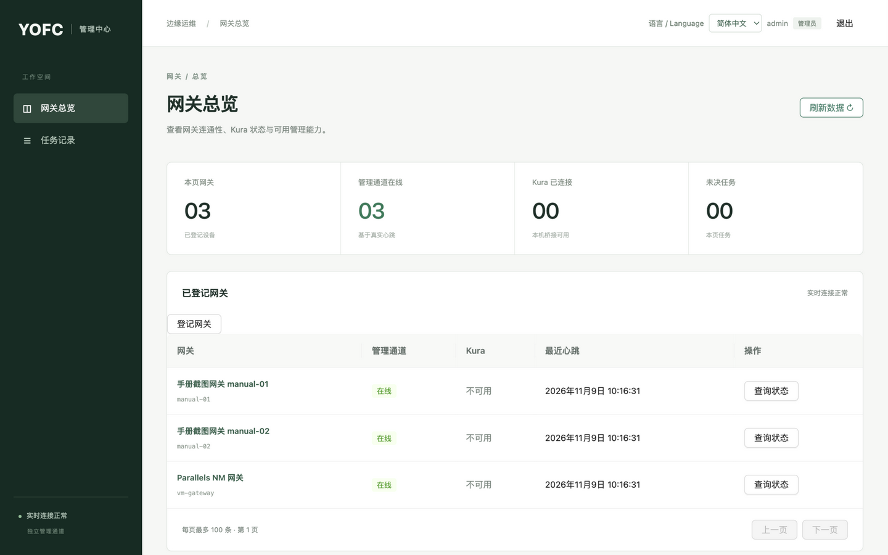

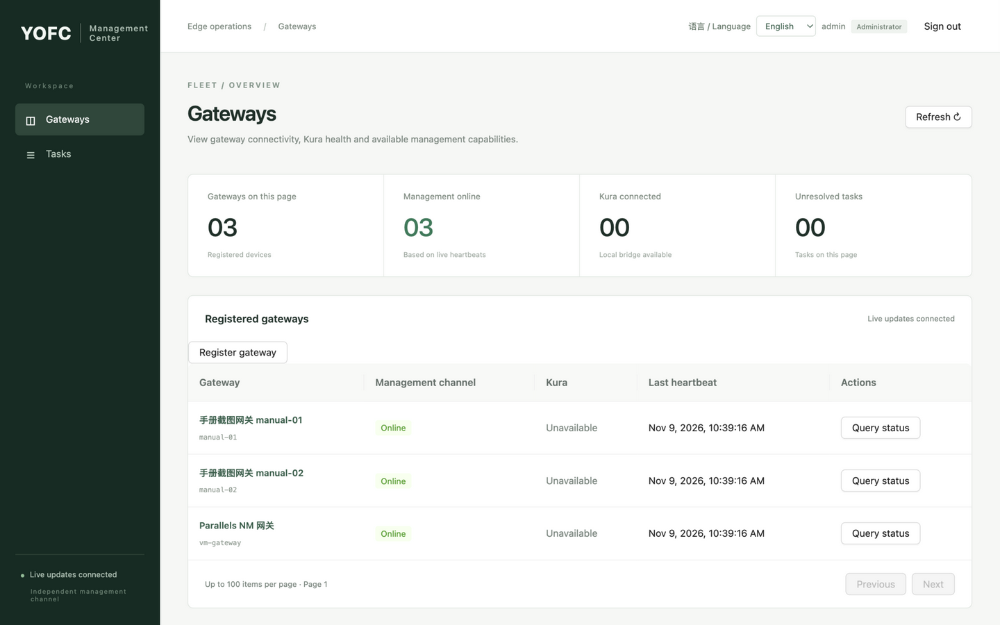

点击网关名称打开详情抽屉，可见能力清单（含 `nm.remote.v1`）、Kura 配置浏览、有线网络、防火墙事务、NM 网络事务、跨中心转移审批：

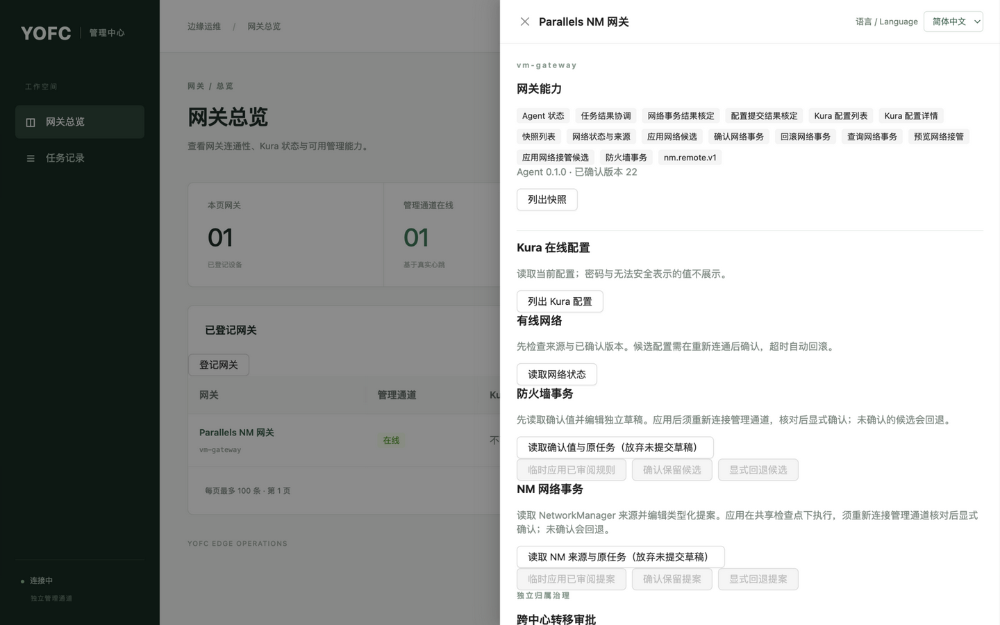

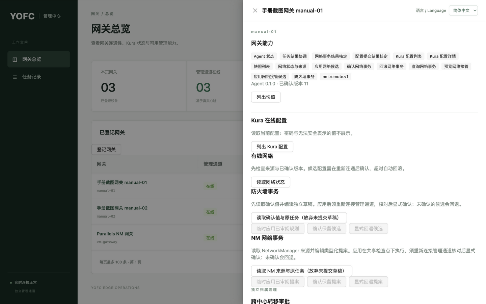

## 3A. 设置页：服务器证书 / 客户端 CA / 任务数据密钥（2026-11-10 新增）

侧栏 **⚙ 设置**（仅管理员）集中管理中心的证书、信任锚与任务密钥。上传先进入待生效暂存区（0600），**中心重启后生效**（容器部署 `docker compose restart console`；entrypoint 应用暂存文件并清空暂存区）。私钥上传后立即 0600 落盘，不再出现在任何响应中；全部操作写审计。

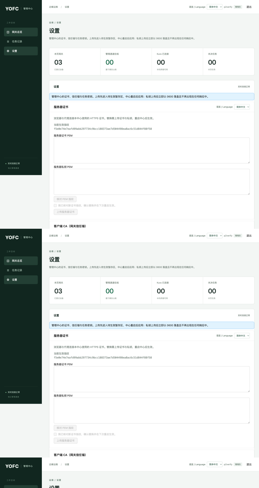

| 区块 | 操作 | 说明 |
| --- | --- | --- |
| 服务器证书 | 上传 server.pem + server.key → 核对指纹 → 勾选确认 → 上传 | 浏览器与代理连接中心的 HTTPS 证书；重启生效 |
| 客户端 CA（网关信任锚） | 上传/替换 CA（显示受影响已登记网关数） | 中心校验网关客户端证书的 CA；**替换影响全部网关**，身份包内 ca.pem 也取自当前生效值 |
| 任务数据密钥 | 备份：输入强口令（≥16 字符）下载加密包；**轮换**：在线重加密全部任务密文并下载新密钥备份；恢复：上传备份包+口令，暂存后重启生效 | 加密任务密文与身份包私钥信封；**密钥丢失等于历史密文不可读**，口令须妥善保存。轮换立即生效（运行态切换新密钥），**必须重启**使磁盘密钥一致；轮换前先备份 |

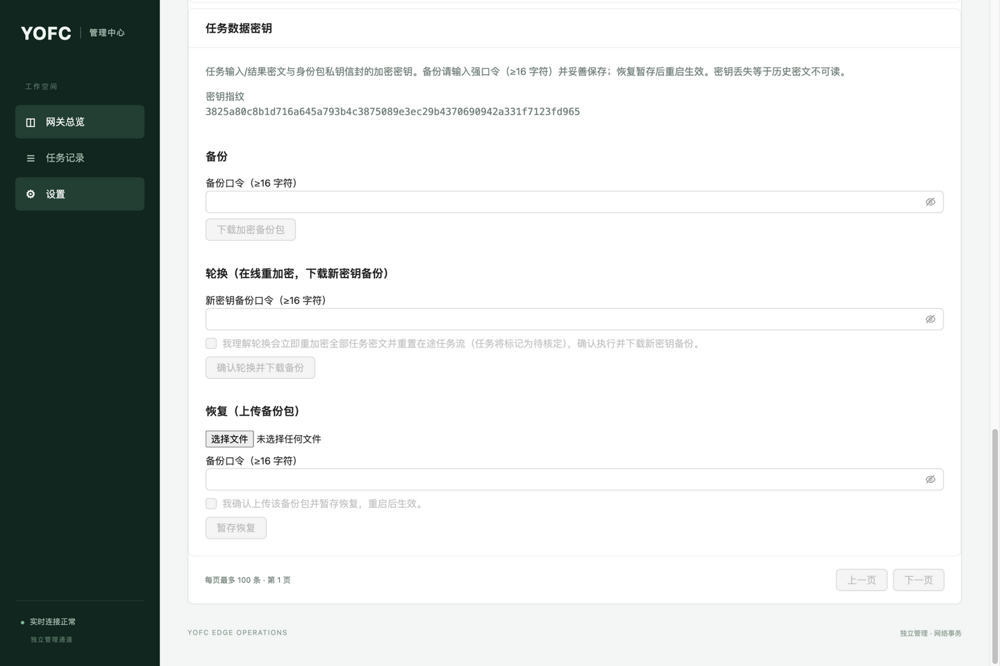

### 3A.1 客户端证书轮换（P2）

网关详情抽屉 **轮换客户端证书**（仅管理员）。两种模式：

- **上传新证书与私钥（下发一次性轮换包）**：中心登记新指纹并重置连接，界面下载 `<网关ID>-rotation-bundle.tar`（manifest 带 `purpose:rotation` 与旧指纹链）。网关侧执行 `sudo kura-agent-setup rotate-bundle <包> --operator <操作者>`——agent 校验包内旧指纹与已装证书一致、证书链匹配当前 CA、证书/私钥配对后原子替换（旧对备份在 `certificate-rotations/N/`）。
- **仅登记新证书（私钥已在网关）**：中心只换指纹；网关侧自行执行 `kura-agent-setup rotate-client-certificate --cert … --key … --operator …`。

安全语义：轮换登记要求提交**当前指纹**作乐观锁（不匹配即 409）；轮换包与身份包共用一次性通道（下载即失效）；中心在线窗口登记，agent 用旧证书的连接被重置后按新证书重连。

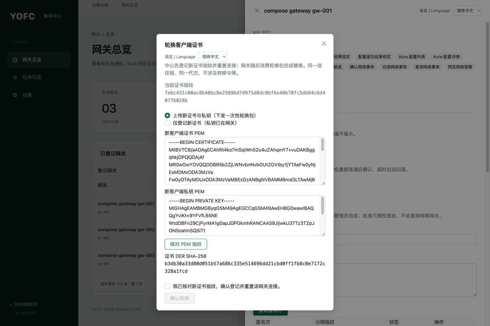

## 4. NM 联合网络事务（中心 → 网关 → NetworkManager）

原则：**读取来源 → 编辑类型化提案 → 临时应用（共享检查点）→ 重连管理通道 → 显式确认**。未确认的提案在确认窗口到期后由 NM 检查点自动回滚；确认要求一个晚于应用时刻的全新管理连接。

### 4.1 读取来源

在详情抽屉 NM 网络事务面板点击 **读取 NM 来源与原任务**。agent 两遍观察 NetworkManager（bus GUID、唯一 owner、设备/活跃连接/profile UUID、版本与哈希），返回来源摘要与（存在时）当前事务：

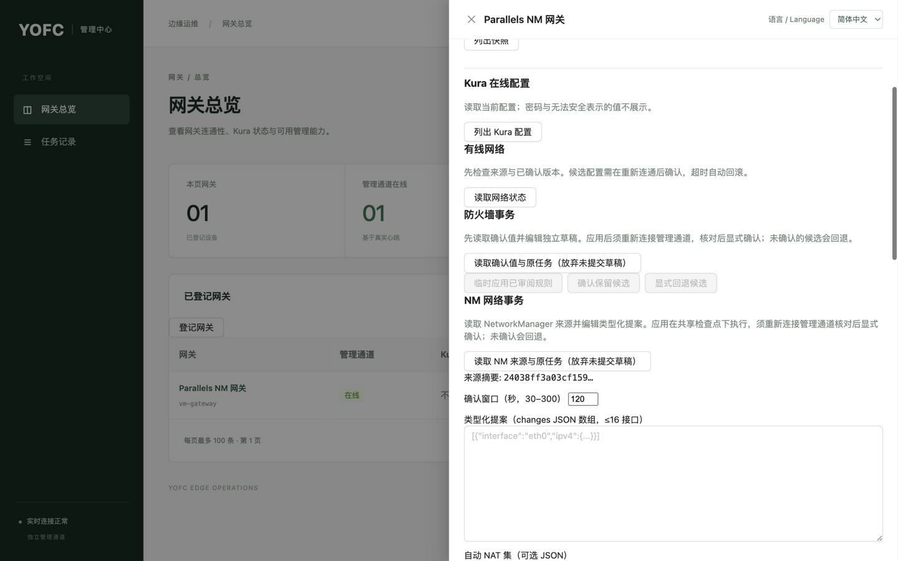

### 4.2 编辑类型化提案

在"类型化提案"文本框输入 changes JSON 数组（≤16 接口），可选填"自动 NAT 集"。例：把 eth0 改为静态 192.0.2.10/24：

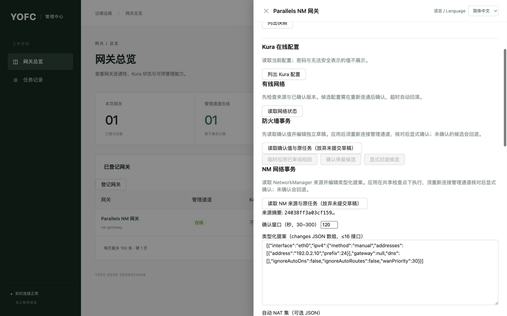

提案保存后（清除旧别名、保留未编辑字段），勾选"已核对本提案及管理入口"，点击 **临时应用已审阅提案**：

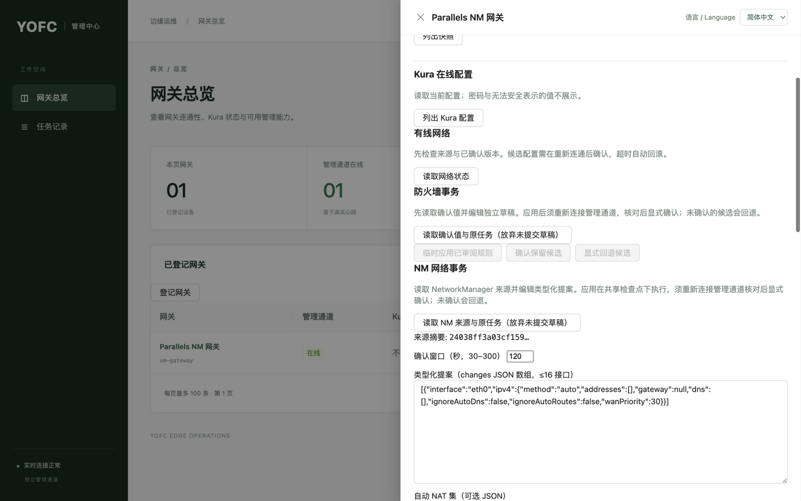

### 4.3 应用：检查点 + Update2 version-id CAS + Reapply

agent 在同一系统变更守卫下依次：`CheckpointCreate` → 逐 profile `Update2(version-id=观察令牌)` → `Reapply` → 读回校验（编辑面逐字段）→ 组装自动 NAT 表（`yofc_nm`，masquerade）。成功进入 **等待确认**，面板显示事务 ID、剩余确认秒数：

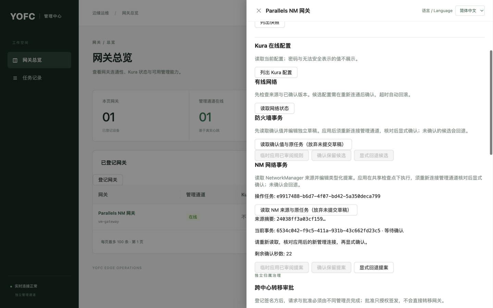

### 4.4 重连管理通道并确认

确认要求一个 **晚于应用时刻** 的全新管理连接（agent 端连接见证；同一连接不能自证）。运维侧等价操作：让 agent 重连（重启服务或等待重连窗口），然后重新 **读取** ——面板出现确认复选框与就绪状态：

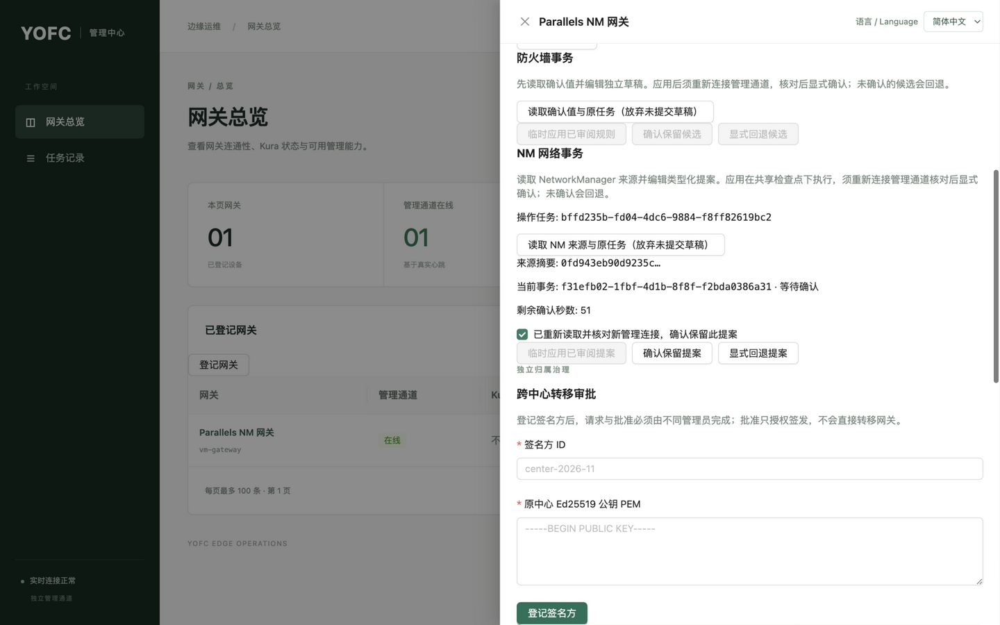

勾选"已重新读取并核对新管理连接"后点击 **确认保留提案**。agent 校验 profile 读回（version-id 已前进、编辑面逐字段一致）→ 销毁检查点 → 写收据，面板显示 **已确认**：

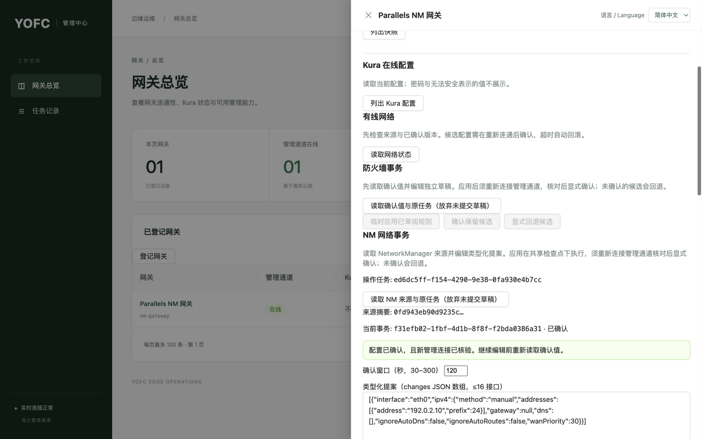

### 4.5 超时回滚与恢复

确认窗口到期未确认：NM 检查点自动回滚，agent 周期裁定写 `ROLLED_BACK` 收据，面板显示"提案已回退"（对应截图 `nm-wait-confirm-zh` 的窗口过期后状态）。若回滚后编辑面未恢复（违反源绑定），事务转 `RECOVERY_REQUIRED` 并在 `nm/rollback-mismatch-*.json` 保留现场，等待运维核定；**不会自动重写**。

历史归档：已回退/已确认事务由 agent 端 `network.nm.archive` 显式移入 `nm/history/`（center UI 暂无按钮），之后才能发起新提案。

## 5. 防火墙事务

同抽屉防火墙事务面板。点击 **读取确认值与原任务** 查看当前确认规则与版本：

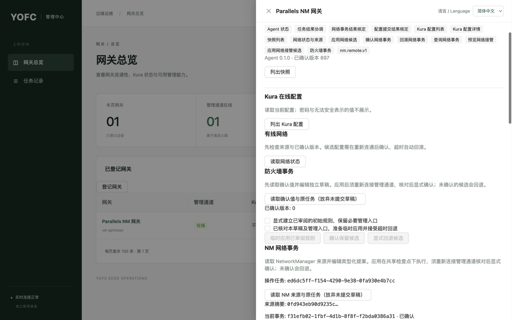

首次部署可勾选 **显式建立已审阅的初始规则，保留必要管理入口**，编辑草稿后勾选草稿审批：

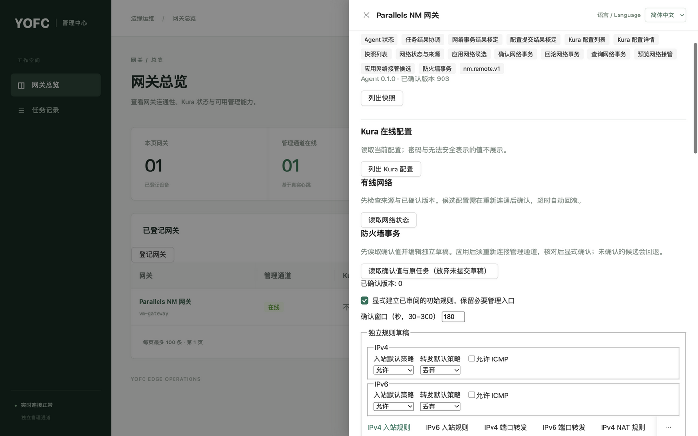

点击 **临时应用已审阅规则** → nft `yofc_kura` 表内核读回校验 → **等待确认**（事务 fw-…，剩余秒数，待确认候选只读展示）：

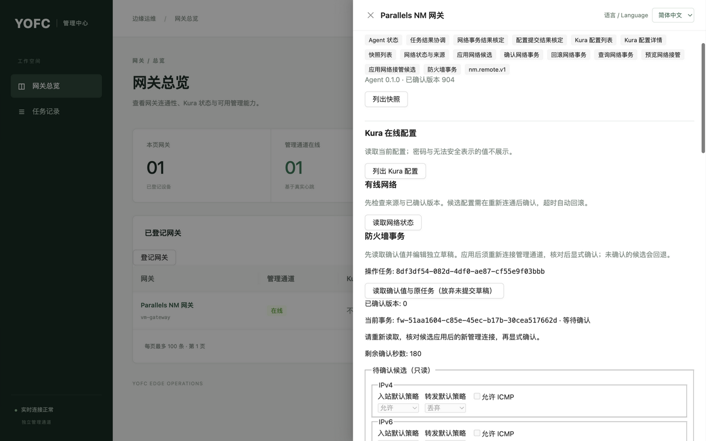

确认/回退与 NM 相同：重连管理通道后重读、勾选、显式确认；未确认超时回退。NAT/转发属于 V3 候选语法（portForward/nat 组），由 agent 编译为 nft 规则。

## 6. 任务记录

侧栏 **任务记录** 查看全部任务的类型、状态与错误（含 NM/防火墙事务任务）：

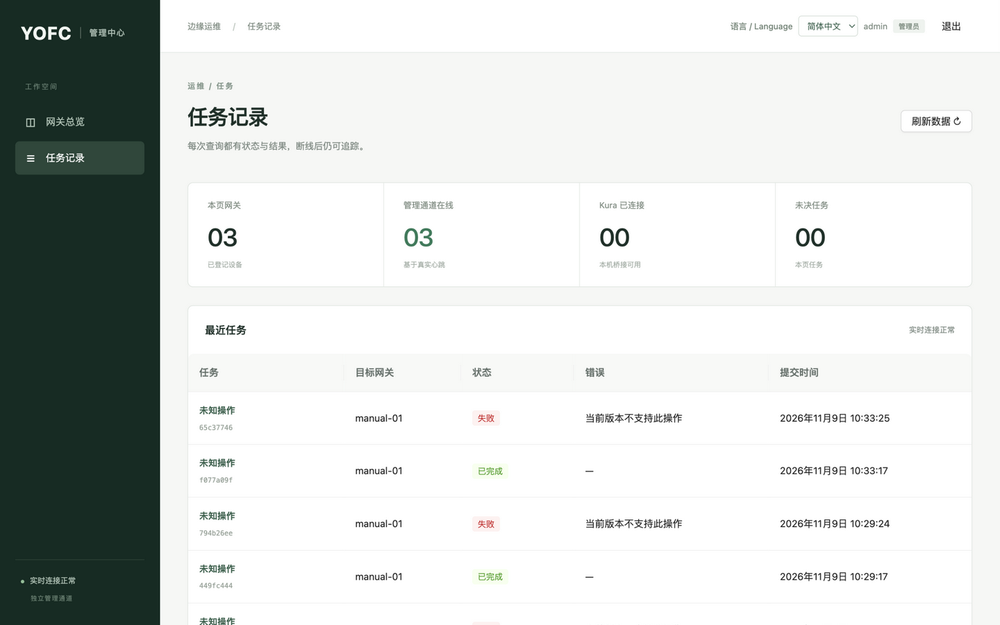

## 7. 排障速查（NM 联合事务专属）

| 症状 | 根因与处理 |
| --- | --- |
| `当前版本不支持此操作`（nm.view UNSUPPORTED） | agent 无 NM capability：NM 未运行 / config `interfaces` 含不存在网卡（如 orb VM 无 eth1）/ 网卡是 veth（DeviceType=20，agent 仅支持 type=1 物理网卡）。补齐接口列表或换真实 NIC 主机 |
| `NM profile requires a supported persistent wired source` | profile 未持久化（`Unsaved=true` 或 `Flags!=0`）。用 keyfile 落盘 `/etc/NetworkManager/system-connections/*.nmconnection`（0600），禁用临时 netplan 渲染（`renderer: NetworkManager`）后 `nmcli con reload` |
| prepare 回 `FORBIDDEN: authenticated connection required` | agent 连接见证早于 apply（同一 gRPC 流）。让 agent 重连（`systemctl restart kura-management-agent`）刷新见证后重读再确认 |
| prepare 回 `OUTCOME_UNKNOWN` | 上一事务未 settle。`network.nm.status` 查看；终态后 `network.nm.archive` 归档再发起新提案 |
| 确认窗口过期 | NM 检查点自动回滚（设计行为）。重新读取确认值、重新编辑提案即可；不视为故障 |
| 心跳被踢（30 秒断连） | 同机有两个 agent 进程（systemd 旧包 + 手工部署）同时连中心互踢心跳。`systemctl disable --now kura-management-agent` 保留一个 |
| 任务卡 UNKNOWN 不消解 | 旧 agent 二进制缺 NM 回执 reconcile（`nm.coordinator.journal.v1`）。升级 agent 至含 journal 白名单与 operationId 投影的版本（v31+，含 seq034-037 修复） |
| agent 起动 `unsafe socket directory` | socket 目录权限非 0700：`chmod 700 /run/kura-management-agent` |
| agent 起动 `No such file or directory` | `AGENT_STATE_DB` 父目录不存在：`mkdir -p /var/lib/kura-management-agent/agent-state` |
| agent 连接 `FORBIDDEN` | `AGENT_GATEWAY_ID` 与登记不一致 / 证书指纹不匹配 / `AGENT_REMOTE_ENABLED` 未开。逐项核对 |
| `import-bundle` 报指纹不符 | 包内文件与 manifest 不一致或传输损坏；重新在中心登记下载（旧包已一次性失效） |
| `import-bundle` 报 Existing or interrupted identity | 网关已有身份：走 `transfer-identity` 或 `apt purge kura-management-agent` 后重装再导入 |
| env 改 `AGENT_REMOTE_ENABLED=1` 仍不连中心 | 远程开关是持久决策（装包时已写 enabled=false）：用 local UDS `remote.set-enabled` 开启（手册 §3 步骤 4） |
| 直接执行 `/usr/lib/kura-management-agent/setup.py` Permission denied | 打包设计：setup.py 无执行位，入口是 `kura-agent-setup` wrapper |
| 身份包下载 404 | 一次性 token 已失效（已下载/过期/吊销）；在中心重新登记生成新包 |
| 设置页上传后未生效 | 上传只进暂存区，需重启中心容器；entrypoint 启动时应用 pending 并打印 `applied pending …` |
| 轮换登记回 409 | 提交的当前指纹与登记不一致（他人已换）或新证书与现证书相同；刷新详情后重试 |
| 轮换包在网关被拒 `different installed certificate` | 包内旧指纹与网关已装证书不一致（发错网关/已轮换过）；作废该包，在中心重新发起 |
| 任务密钥轮换后在途任务 UNKNOWN | 轮换重加密会重置在途任务流（设计行为）：任务按原命令核定，agent 自动重连后恢复，不会自动重试 |
| create-certificate-request 报 pending already exists | 已有待激活请求：先 `activate-pending-certificate` 或删除 `STATE/certificate-requests/` 重来 |
| activate-pending-certificate 报 does not match the locally generated key | 证书不是由该网关 CSR 签发（或 CSR 重生成过公钥变化）；重新签发匹配的证书 |

---

附：§3A 与登记向导身份包截图来自 2026-11-10 docker compose 实例（settings-page-zh / register-bundle-download-zh）；其余截图环境为 2026-11-09 临时实例（Mac phase1-dev 独立 PostgreSQL/证书，专用 `.phase1-dev` 目录；Parallels Ubuntu 26.04 真实 NM 1.54.3 网关一台；OrbStack Ubuntu 24.04 网关两台，其中 NM 联合事务截图取自 Parallels 物理网卡网关）。测试用密码、身份文件与 fixture 在截图后清理；生产中心/代理未动，无 commit/push。NM 检查点、Update2 version-id CAS、NAT 组装、连接见证与恢复裁定语义见合同 `kura-management-console/docs/nm-firewall-coordination-v1.md` 与 `kura-management-agent/docs/nm-joint-writer-v1.md`。
