# YOFC 管理体系操作手册（中心 + 网关代理 + Web 控制台）

当前审查候选：`console 0.1.0~review20261105-1`、`agent 0.1.0~review20261105-2`，均为 arm64。中心已在 Ubuntu 26.04 Parallels 干净安装、命名实例、remove/reinstall/purge 实验；agent 当前 ELF 已在 Ubuntu 24.04 OrbStack 和 26.04 Parallels 隔离系统单元验证。amd64、完整恢复与正式发行仍开放。更新日期：2026-11-05。

下方 2026-11-03 的包 26/20 命令输出和原截图保留历史适用性；最新检查与制品 SHA 见 `../reviews/quality-architecture-refactor-20261104.md`。原截图来自当日源码临时实例，不能据此认定旧 console26 payload 拥有全部界面。

本手册覆盖三部分：**安装与初始化**（§1–§3）、**卸载与升级**（§4–§5）、**Web 控制台操作**（§6，含全部截图）。§7 为中心 CLI 速查，§8 为排障速查。

约定：

- 命令在目标主机以 root 执行；`console.env` 等凭据文件一律 0600，不得进入日志或命令历史。
- 标有包版本的历史输出按该版本保留；命令示例须替换为审核过的候选包。控制台截图来自实际测试实例。
- 中心认证、网关注册完全独立于 Kura Web 账号；Kura 停止不影响中心/代理/控制台。

架构一句话：浏览器 —HTTPS/会话—> **中心 console**（Rust，PostgreSQL 权威库，React 同源前端）<—mTLS gRPC 双向流— **网关代理 agent**（Rust systemd 服务）—UDS/OS 身份—> Kura JVM（只读桥接）以及 Netplan/nftables/系统控制（受权限白名单约束）。

---

## 1. 安装前准备

| 依赖 | 说明 |
| --- | --- |
| PostgreSQL 15+ | 中心权威库；每个中心实例一个独立数据库（外部运维，包管理不接管） |
| python3 | 包内 setup/lifecycle 脚本运行时 |
| systemd | console/agent 均为 systemd 服务（含模板单元 `@.service`） |
| nftables（agent 主机） | 防火墙引擎调用 `/usr/sbin/nft`；包依赖已声明 |
| 证书材料 | 中心 server 证书（含 SAN）+ 网关 client 证书（由中心 client CA 签发，EKU clientAuth）；网关身份三件套 `ca.pem / agent.pem / agent.key` |

端口规划（可按部署调整，与 `console.env` 一致）：浏览器 HTTPS（示例 18443/28443）、agent gRPC/mTLS（HTTPS+1，示例 18444/28444）。

## 2. 中心（console）安装与初始化

```console
# 1) 安装（postinst 不自动启动）
# dpkg -i kura-management-console_0.1.0~package20261102-26_arm64.deb
Selecting previously unselected package kura-management-console.
Unpacking kura-management-console (0.1.0~package20261102-26) ...
Setting up kura-management-console (0.1.0~package20261102-26) ...
Installed without starting. Configure TLS and task key, migrate, then explicitly activate.
```

初始化四步（`/etc/kura-management-console/console.env` 需先填好 `DATABASE_URL / CONSOLE_DATA_KEY_FILE / CONSOLE_ORIGIN / CONSOLE_HTTP_ADDR / CONSOLE_GRPC_ADDR / CONSOLE_TLS_CERT / CONSOLE_TLS_KEY / CONSOLE_CLIENT_CA / CONSOLE_WEB_DIR`，模板见 `/usr/share/doc/kura-management-console/console.env.example`）：

```console
# /usr/lib/kura-management-console/setup.py init-key /var/lib/kura-management-console/task-data.key
# /usr/lib/kura-management-console/setup.py migrate
[2m…[0m INFO yofc_management_console: task storage key verified migrated_tasks=0
# /usr/lib/kura-management-console/setup.py check
# /usr/lib/kura-management-console/setup.py activate
Agent setup completed: activate
```

健康检查（路径是 `/health/ready`，不是 `/api/v1/health`）：

```console
# curl -sk https://127.0.0.1:18443/health/ready
{"protocolMajor":1,"status":"ready"}
```

空库初始化按产品要求提供 **admin/admin**。首次认证成功后必须先设置新密码并确认（至少 12 个字符），无需再填当前密码；设置成功直接进入控制台。服务端在此之前拒绝其他管理 API，刷新和另开会话都不能绕过；成功后原 admin 密码失效。普通后续改密仍要求当前密码。中心账号与 Kura 原控制台账号分别维护。

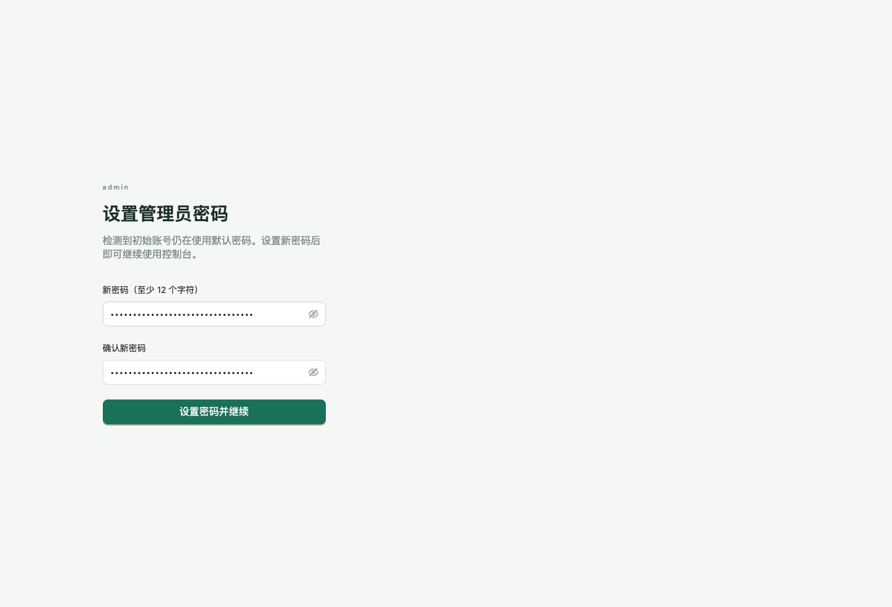

本图来自本轮 OrbStack 当前中心 ELF/React；相同流程另在 Parallels 实际安装的候选包验证。密钥和测试密码不写入本手册。网关登记仍见 §7 CLI 速查。

### 2.1 多实例（第二中心）

布局与契约见 `docs/center-instances-v1.md`。以 `center2` 为例：

```console
# /usr/lib/kura-management-console/setup.py --instance center2 init-instance   # 只建目录/marker
# 编辑 /etc/kura-management-console-center2/console.env（独立 DB/TLS/origin/端口）
# /usr/lib/kura-management-console/setup.py --instance center2 init-key /var/lib/kura-management-console-center2/task-data.key
# /usr/lib/kura-management-console/setup.py --instance center2 migrate
# /usr/lib/kura-management-console/setup.py --instance center2 check
# /usr/lib/kura-management-console/setup.py --instance center2 activate
```

手工进程纳入 systemd 前的显式交接（不删状态，仅修属主/权限）同样见该契约；失败时不要用删数据绕过 `check`。

## 3. 网关代理（agent）安装与身份导入

```console
# dpkg -i kura-management-agent_0.1.0~package20261103-20_arm64.deb
Setting up kura-management-agent (0.1.0~package20261103-20) ...
Installed without starting. Import registered identity, authorize Kura if needed, then explicitly activate.
```

身份必须先在中心 `register-gateway` 登记同一 client 证书（§9），再导入 agent：

```console
# systemctl stop kura-management-agent.service   # 首次安装未运行，可跳过
# /usr/lib/kura-management-agent/setup.py import-identity \
    --endpoint https://center1.example:18444 --gateway gw-001 \
    --ca /private/ca.pem --cert /private/agent.pem --key /private/agent.key
# /usr/lib/kura-management-agent/setup.py check
# /usr/lib/kura-management-agent/setup.py activate
Agent setup completed: activate
# systemctl is-active kura-management-agent.service
active
```

要点：

- `--key` 必须是 0600 归属正确的常规文件（0644 会被正确拒绝）。
- 导入写入 `AGENT_BINDING_GENERATION=1`；缺代次或 0 代次的旧身份需显式 `migrate-binding-generation`。
- 网关在控制台显示 **在线**（基于真实 gRPC 心跳）后才可下发命令。

### 3.1 Kura 只读授权（可选）

允许本机 Kura JVM 经 UDS 注册只读桥接（不授予任何网络/恢复权限）：

```console
# systemctl stop kura-management-agent.service
# /usr/lib/kura-management-agent/setup.py authorize-kura --user kura-netplan
# /usr/lib/kura-management-agent/setup.py activate
```

### 3.2 网络写入者：授予与交接（显式，默认无）

安装后 `AGENT_NETWORK_INTERFACES` 为空——代理**不写网络**。授予与归还是显式命令（详见 agent `packaging/README.md`）：

```console
# 授予（要求停服、无未决事务、无残留 writer/confirmed state）
# /usr/lib/kura-management-agent/setup.py grant-network-writer --interfaces eth0 --operator 'ops-a'
# 交接回系统（默认保留受管 Netplan 文件，归档确认状态并解除 purge 阻挡）
# /usr/lib/kura-management-agent/setup.py handover-network-writer --operator 'ops-a'
# 连受管文件一并删除（仅当与确认内容逐字节一致；漂移拒绝）
# /usr/lib/kura-management-agent/setup.py handover-network-writer --operator 'ops-a' --discard-config
```

writer 在位期间，包生命周期（升级/卸载）会被 `Explicit network writer handover required` 拒绝——先交接。

### 3.3 防火墙与离线恢复的能力开关

- 防火墙：`AGENT_FIREWALL_WRITE=0` 默认关闭；审核后显式设为 1 才开放 prepare/apply/confirm。管理自有表 `inet yofc_kura`（UDS `firewall.*`，本版本无 Web/中心协议面），unit 限定 `CAP_NET_ADMIN`。prepare 的 token 只返回给获授权的发起方；未决事务或外部规则集挡写。NAT/转发仍未实施。
- 离线恢复：**默认禁用**。审核 `AGENT_RECOVERY_UNITS` 和单一快照目录，并按包内 `recovery.conf.example` 显式配置受限 `ReadWritePaths` 与保留属主所需能力后启用。上述旧包候选只证明 opaque 制品和 unit 行为，`kuraRecoveryVerified=false`；不证明 Kura XML/加密/业务恢复。RECOVERY_REQUIRED 不可被新 prepare 覆盖；旧制品模式可在核对现场后使用带原事务令牌的 rollback 补偿。原始备份、回执和漂移文件保留。

源码另有显式 Java 校验和受控 Kura 启动增量，尚未进入正式发行。`AGENT_RECOVERY_STARTUP_CONFIG` 固定 profile/请求路径，仅在核对实际 CM 回执后进入 `AWAITING_COMPLETION`，普通配置写仍挡住，`kuraRecoveryVerified=false`。受控启动意图一旦发出，普通 rollback **不能还原 CM，也不能放行**；故障停服并保留 `RECOVERY_REQUIRED`，等待 CM 级补偿/明确完成流程。禁止删请求、清 journal 或普通重启冒充完成。恢复 UDS 超时为 `OUTCOME_UNKNOWN`，只查询原事务，不自动重发。合同见 [受控启动授权](../../../kura-management-agent/docs/controlled-startup-v1.md)。

## 4. 卸载与数据保留

### 4.1 中心

```console
# 普通卸载（程序移除；operator 配置、TLS、task key、key backup、外部 PostgreSQL 全部保留）
# dpkg -r kura-management-console
# 同版本重装：dpkg -i <同一deb>（payload 恢复，显式 activate 即可）
# purge（同样不删除数据库与 key）
# dpkg -P kura-management-console
# purge 后恢复安装：
# dpkg -i <deb> && setup.py migrate && setup.py check && setup.py activate
```

| 数据 | remove | purge |
| --- | --- | --- |
| 包 payload（二进制/前端/unit） | 移除 | 移除 |
| `/etc`、`/var/lib` 下实例配置与状态（含 task key、TLS） | 保留 | 保留 |
| 外部 PostgreSQL 数据 | 保留 | 保留 |

> 数据库备份/回放属 DBA 运维；task key 丢失等于历史任务密文不可读（可用 `task-key-backup/restore` 预先备份，见 §9）。

### 4.2 网关代理

```console
# 卸载前若授予过网络写入者，必须先交接（否则 purge 被拒）：
# /usr/lib/kura-management-agent/setup.py handover-network-writer --operator 'ops-a'
# dpkg -r kura-management-agent        # 或 dpkg -P …（purge 同样先过 writer/未决事务守卫）
```

purge 会清理 `/etc/kura-management-agent`、`/var/lib/kura-management-agent`、`/var/log/kura-management-agent` 与 Kura 授权 drop-in；**不动 Kura 自身数据、不动已交接给系统的网络/防火墙**。

## 5. 升级

```console
# dpkg -i kura-management-console_…-27_arm64.deb
Preparing to unpack …/kura-management-console_…-27_arm64.deb …
Unpacking kura-management-console (…-27) over (…-26) …
```

- 升级前 `preinst`/`prerm` 会枚举默认实例与全部 `@instance`：存在 `QUEUED/RUNNING/UNKNOWN` 任务时**拒绝维护**（输出形如 `Stop the packaged console`/任务未决提示）。等任务落终态或显式处理后重试。
- 升级完成后服务保持停止，需逐实例 `migrate`（应用新迁移）→ `check` → `activate`。
- agent 升级同理（激活前 `check`）；带新能力的 agent 上线前，中心需先升级到兼容版本（如撤销检查要求中心先有对应 RPC）。

## 6. Web 控制台操作

登录中心 HTTPS 地址（示例为测试实例）。界面持续中英文，右上角 `语言 / Language` 随时切换，选择保留、未提交草稿不丢。

### 6.1 登录

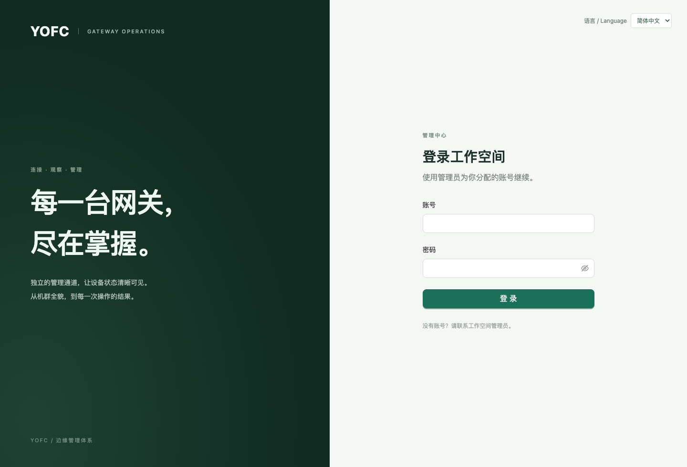

输入管理员账号密码，点击 **登 录**。密码错误会得到明确文案（不泄露账号是否存在）：

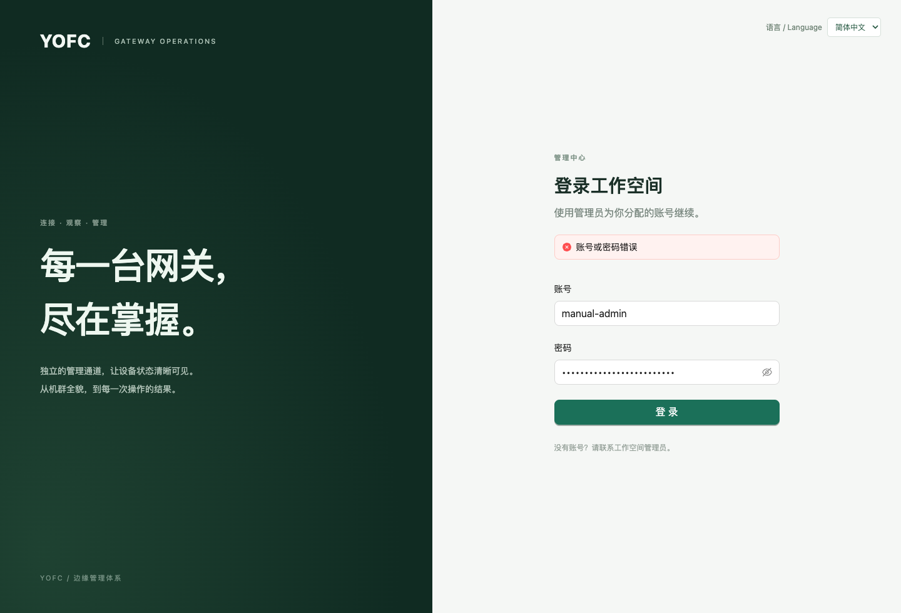

### 6.2 网关总览

登录后进入 **网关总览**：统计卡（网关数/管理通道在线/Kura 已连接/未决任务）+ 网关列表（在线徽标、最近心跳）。

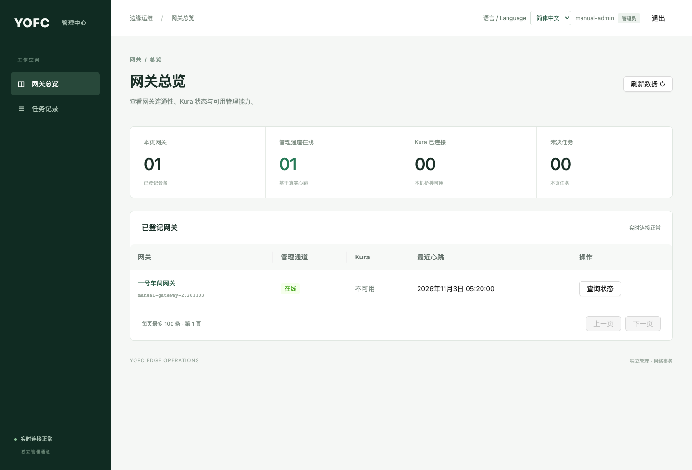

点击行内 **查询状态** 对该网关下发 `agent.status` 只读探测（成功后任务进入任务记录）：

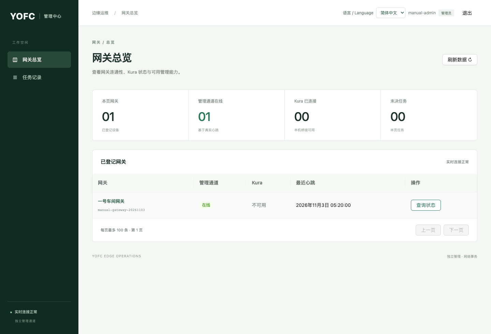

### 6.3 网关详情

点击网关名称打开详情抽屉：网关 ID、能力清单、管理通道与 Kura 连接状态。

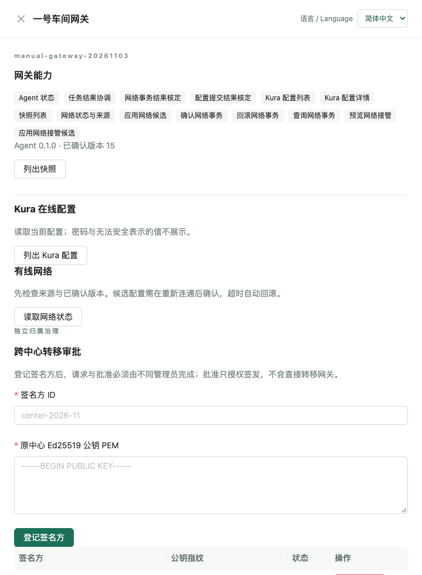

### 6.4 跨中心转移审批（独立归属治理）

详情抽屉内为“跨中心转移审批”面板。原则：**普通登记不抢占归属；跨中心转移必须显式审批 + 一次性签名 token（CLI 签发，浏览器不经手 token 字节）**。

面板三段（截图为同一面板的分屏）：

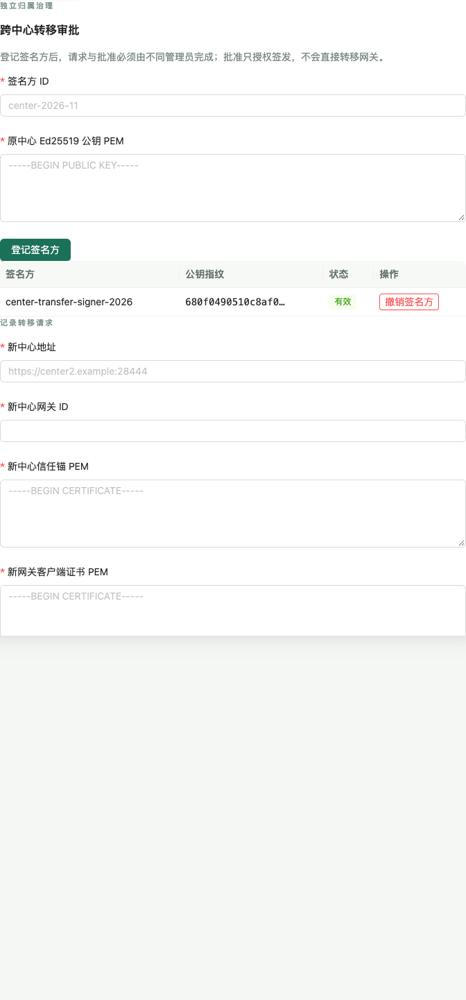

1. **签名方**：登记原中心 Ed25519 公钥（`KEY_ID + PEM`，幂等）；可撤销。
2. **记录转移请求**：填写新中心地址/新网关 ID/新信任锚与新客户端证书 PEM，勾选确认当前 generation → 目标 generation 后 **记录请求**；由**另一名**管理员 **批准**（或拒绝/撤销）。
3. **已签发转移授权**：批准后由中心 CLI 签发一次性 token（§9），此处可见 `有效/已撤销` 状态；发现误签发可 **撤销授权**——只阻止尚未消费的 token，已完成的转移不受影响，审批不会重开。

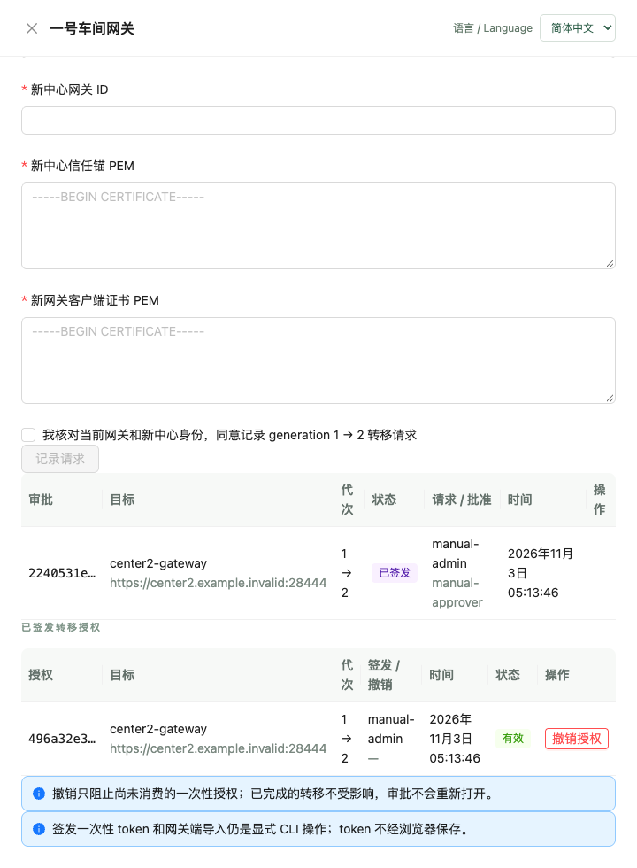

网关端消费 token 即 `setup.py transfer-identity … --authorization-token <file>`（agent 侧在消费前还会向原中心做 mTLS 撤销检查，非 ACTIVE 一律拒绝）。

### 6.5 任务记录

侧栏 **任务记录** 查看全部任务的类型、状态与结果（截图中的 `agent.status` 即 §6.2 的探测）：

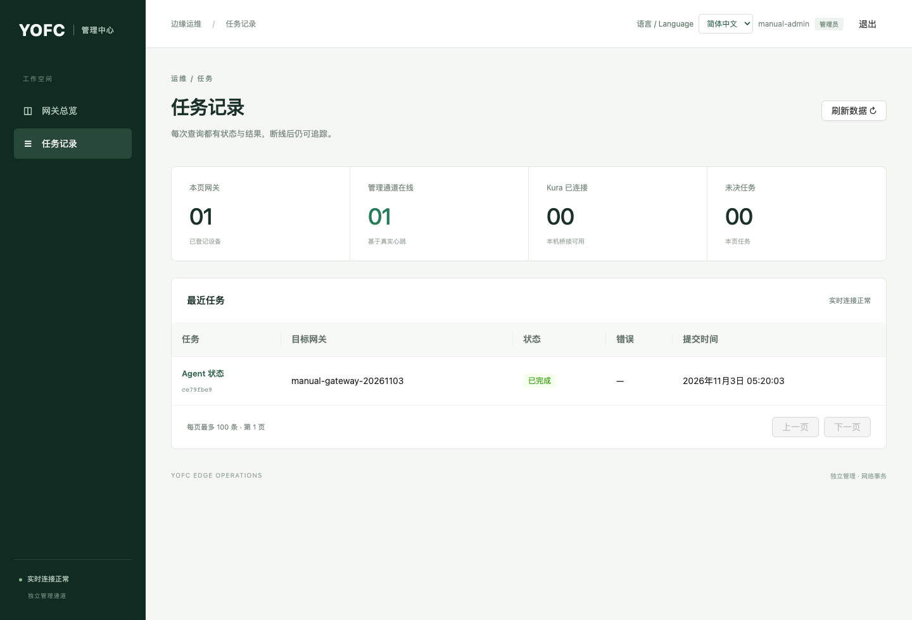

### 6.6 英文界面

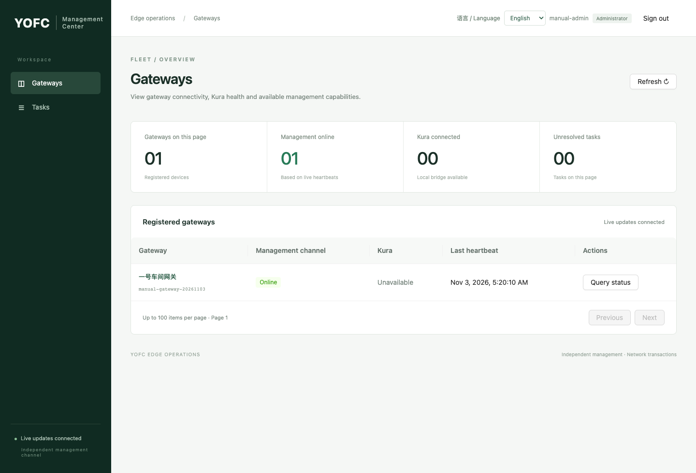

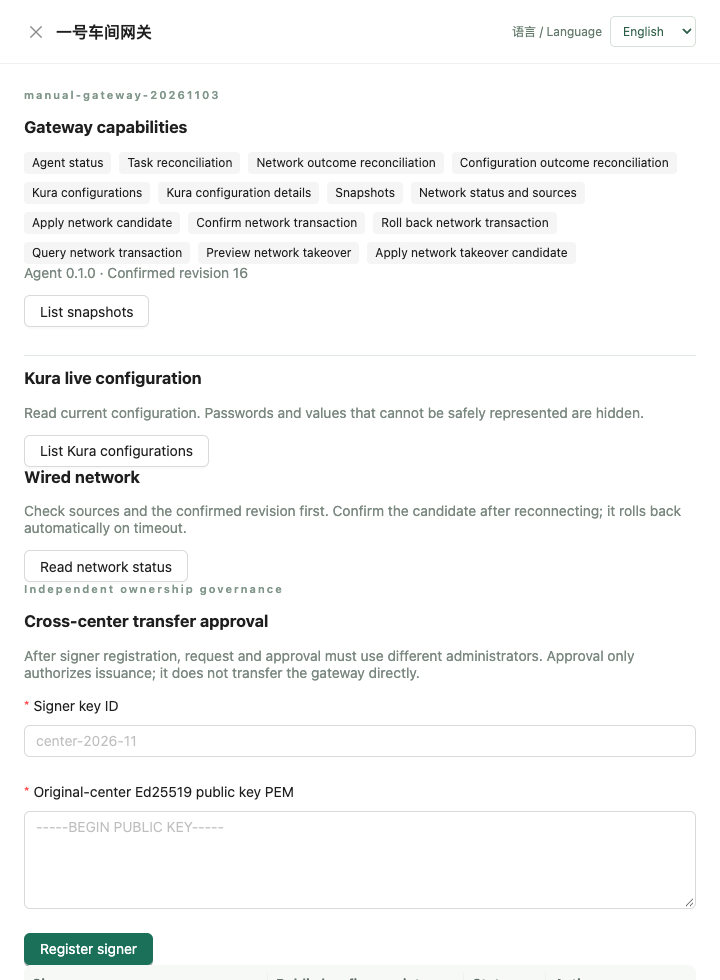

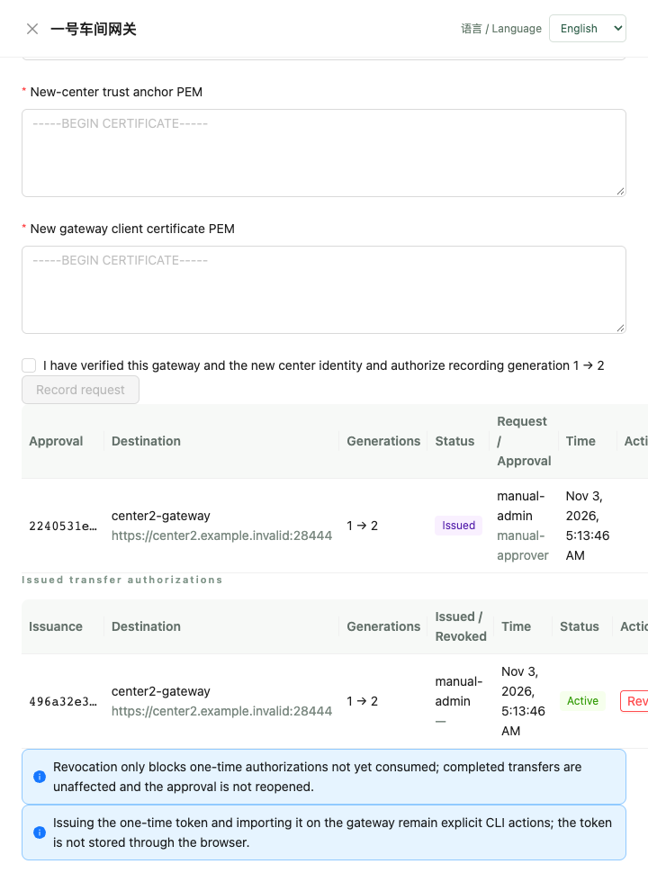

## 7. 中心 CLI 速查

均以对应实例身份执行（root 运行 `setup.py` 包装；直接调用二进制需 `runuser -u yofc-console` 并带实例 env）。

| 命令 | 用途 |
| --- | --- |
| `create-user USERNAME TENANT ROLE PASSWORD_FILE` | 建用户（role: admin/operator/viewer/recovery） |
| `register-gateway GATEWAY_ID TENANT NAME CLIENT_CERT_PEM` | 登记网关（绑定 client 证书 SHA256） |
| `set-gateway-enabled GATEWAY_ID true\|false` | 启用/禁用（禁用即断开并拒绝重连） |
| `rotate-gateway-certificate GATEWAY_ID CERT_PEM` | 同中心叶证书轮换（停机窗口内登记，agent 侧配 `rotate-client-certificate`） |
| `set-gateway-binding-generation GATEWAY_ID N` | 显式代次修正 |
| `generate-transfer-key PRIVATE_KEY_DER PUBLIC_KEY_PEM` | 生成转移签名方密钥对 |
| `register-transfer-signer KEY_ID PUB_PEM TENANT ACTOR_UUID` | 登记转移签名方（幂等，撤销后同 KEY_ID 不可复活） |
| `request-gateway-transfer-approval GATEWAY GEN NEW_ENDPOINT NEW_GW NEW_CA NEW_CERT REQUESTER` | 记录转移请求（同网关仅一个 open 请求） |
| `approve-gateway-transfer-approval ID APPROVER` | 另一管理员批准 |
| `reject-gateway-transfer-approval ID ACTOR` / `revoke-…approval ID ACTOR` | 拒绝 / 撤销 open 请求 |
| `issue-gateway-transfer … TOKEN_FILE` | 双人批准后一次性签发 token（1–900s，审批被消费，交付失败需重新申请） |
| `revoke-transfer-issuance TRANSFER_ID ACTOR` | 撤销未消费 token |
| `issue-transfer-signer-rotation …`（离线） | 签发签名方轮换授权（agent 端 `rotate-transfer-signer` 消费） |
| `task-key-init / backup / restore / rotate` | 任务数据密钥生命周期（备份/恢复需 0600 passphrase 文件 ≥16 字节） |

## 8. 排障速查

| 症状 | 根因与处理 |
| --- | --- |
| 登录返回 403 | `Origin` 头与该实例 `CONSOLE_ORIGIN` 不一致（如用 `localhost` 访问但 origin 配的是 `127.0.0.1`）。以 origin 同源地址访问，或显式修正配置后重启实例 |
| `/api/v1/health` 404 | 健康路径是 **`/health/ready`** |
| 控制台网关一直“等待首次连接” | agent 未启动/未导入身份/gRPC 端口不通；`systemctl status kura-management-agent`、`journalctl -u kura-management-agent`，确认 endpoint 指向中心 **gRPC** 端口（HTTPS+1） |
| agent 反复 `control disconnected` | 证书链/指纹不匹配或代次不符：Hello 的 `binding_generation` 必须等于中心登记值；client 证书必须与 `register-gateway` 登记的一致且在允许列表内 |
| 升级/卸载被拒 | preinst/prerm 守卫：中心有 `QUEUED/RUNNING/UNKNOWN` 任务或 agent writer 在位/事务未决——按 §5/§3.2 收尾后重试 |
| `transfer-identity` 拒绝 | 代次不匹配、claims 不精确、token 过期/已用/已撤销（消费前有 mTLS 撤销检查）、有未决副作用事务——逐项核对，重新走审批签发，**不得重放旧 token** |
| task key 相关 | 旧 key 重入被版本保护拒绝；恢复用 `task-key-restore` + `migrate`；passphrase 文件须 0600 且 ≥16 字节 |
| staged 调试连不上中心 | staged agent.env 中 `AGENT_STATE_DB/AGENT_CA/CERT/KEY/SOCKET` 是**绝对路径**（指向生产）；临时实例调试须逐项覆盖（含 0700 归属的 socket 目录），切勿与生产 state 混用 |

---

附：本手册截图由 2026-11-03 对当前源码构建的临时实例（专用 DB/证书，事后已清理，生产中心/代理未动）与真实浏览器交互采集；命令转录来自同日实测。更早版本的界面（如无“已签发转移授权”表的 console ≤26 payload）以实物为准升级后参照本手册。
