# YOFC 管理中心 + 网关代理完整操作手册（方案 A · 从零到在线）

本手册覆盖**从零部署到第一台网关在线**的完整流程，全部关键步骤配有真实操作截图。按顺序执行即可；示例值（网关 ID `gw-001`、端口 18443/18444、演示口令等）可替换为你自己的。

**方案 A 架构**：CA 私钥不进中心。证书由脚本预生成（或你的自有 CA），中心控制台只做上传、登记与一次性身份包下发；网关私钥只出现在身份包下载中一次。

约定：

- 「中心」= Docker Compose 部署的管理中心（console + PostgreSQL），浏览器访问 `https://<部署机IP>:18443`
- 「网关」= 运行 YOFC 网关代理（kura-management-agent）的 Linux 机器（arm64/amd64），SSH 可达
- 中心两端口：18443（浏览器 HTTPS）、18444（网关 gRPC/mTLS）

---

## 0. 前置条件与清理现场

| 条件 | 说明 |
| --- | --- |
| 部署机 | 安装 Docker + Compose v2（`docker compose version` 可用） |
| 端口空闲 | 18443/18444 未被占用：`lsof -i :18443 -i :18444` |
| 网关 SSH | 能 `ssh <用户>@<网关IP>`，有 sudo 权限 |
| 网关系统 | Ubuntu 24.04+（glibc ≥ 2.39），有 python3、openssl、systemd |

**重头做起（清空旧数据）**——会删除中心全部用户/网关/任务记录与演示证书，确认无生产数据后执行：

```sh
cd kura-management-console/docker
docker compose down -v          # 删除容器与数据卷（PostgreSQL + 任务密钥）
rm -rf tls                      # 删除旧演示证书
```

同时删除浏览器里旧实例的标签页与已下载的旧身份包（`~/Downloads/*-identity-bundle.tar`），避免误用失效包。

## 1. 生成证书并启动中心

```sh
cd kura-management-console/docker
./tls-gen.sh                    # 演示 CA + server 证书 + gw-001..003 网关身份
docker compose up -d
curl -sk https://localhost:18443/health/ready
# {"protocolMajor":1,"status":"ready"}  即就绪
```

- `tls/` 里的 `gw-001.pem / gw-001.key` 是给网关用的客户端证书与私钥（下面登记时上传）。
- 生产环境请用你的自有 CA 证书替换 `tls/{server.pem,server.key,ca.pem}`（可在 §3 设置页上传，或直接替换文件后重启）。

## 2. 首次登录并设置管理员密码

浏览器打开 `https://localhost:18443`（自签证书需接受警告）：

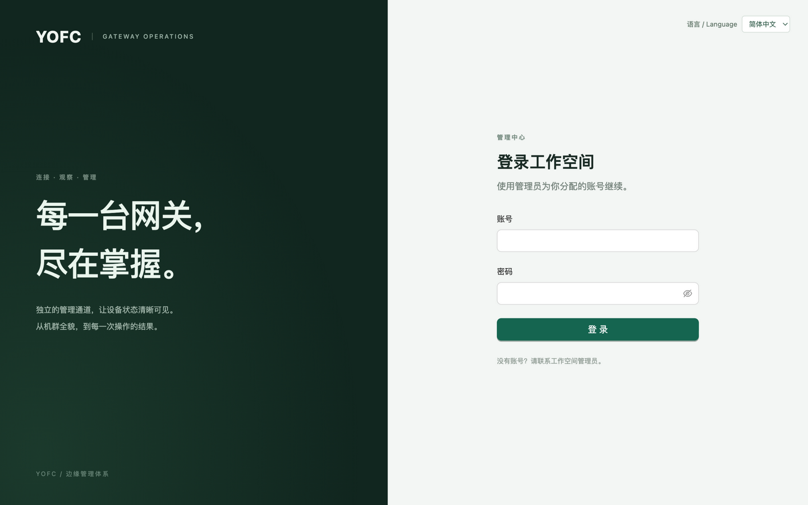

输入初始账号 **admin / admin**：

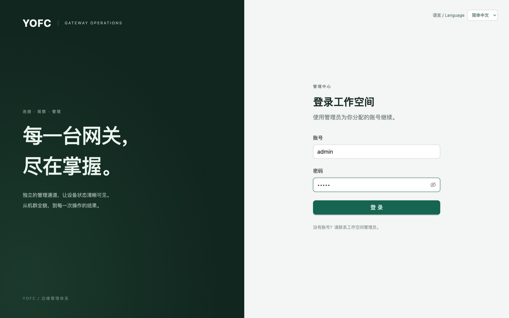

登录后强制设置新密码（至少 12 字符）：

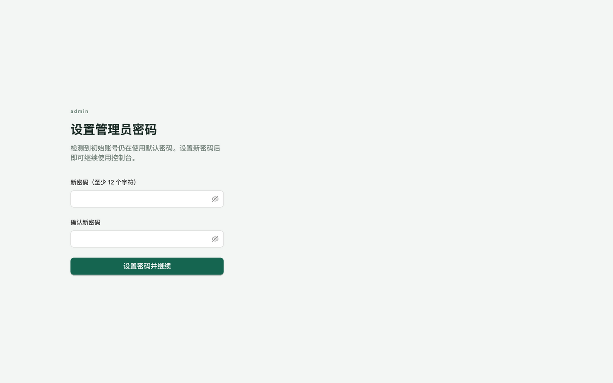

输入并确认新密码（本文演示用 `yofc-Runbook-2026`，请替换为你自己的强口令）：

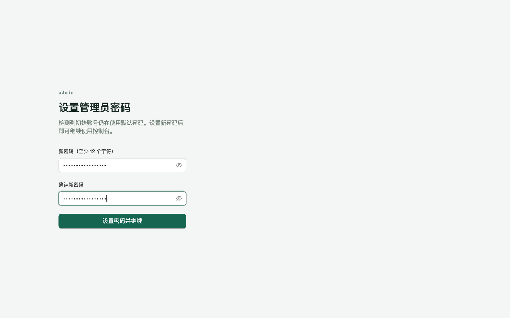

设置成功即进入控制台，原 admin/admin 立即失效。空库总览显示 0 台网关：

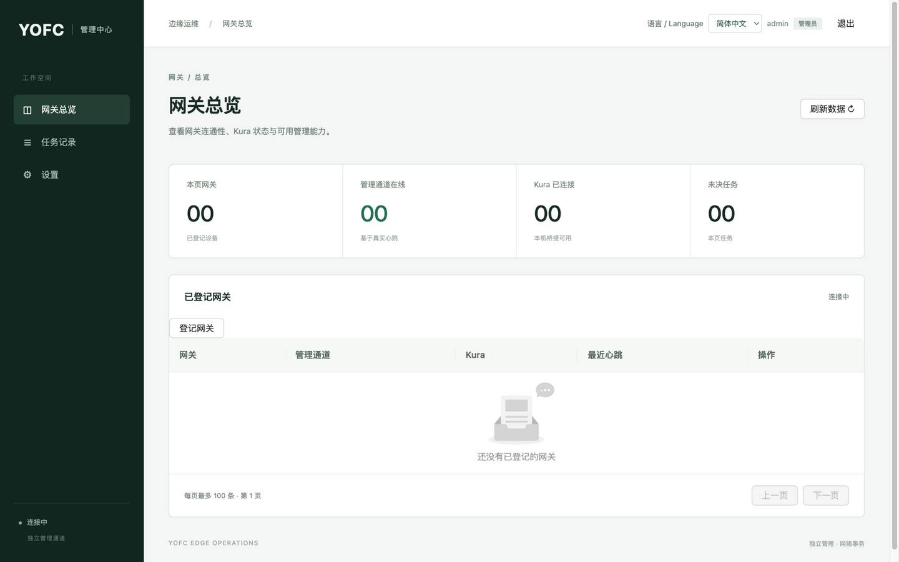

## 3. 认识设置页（可选：上传正式证书）

侧栏 **⚙ 设置**（仅管理员）：

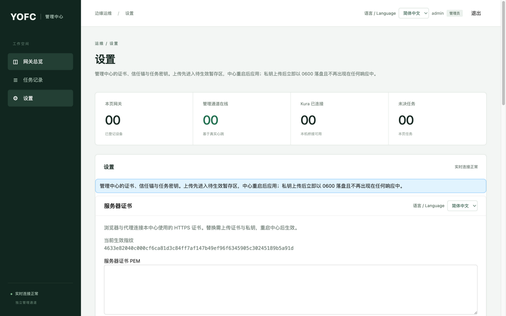

| 区块 | 用途 | 生效方式 |
| --- | --- | --- |
| 服务器证书 | 浏览器与网关连接中心的 HTTPS 证书 | 上传后**重启容器**（`docker compose restart console`），entrypoint 自动应用 |
| 客户端 CA（网关信任锚） | 中心校验网关证书的 CA；身份包内 ca.pem 取自当前生效值 | 同上；替换影响全部已登记网关 |
| 任务数据密钥 | 任务密文与身份包信封的加密密钥：备份 / 轮换 / 恢复 | 备份即时下载；轮换持久保存恢复材料并在线生效，无需重启；恢复先核对数据库绑定，暂存后重启生效 |

演示部署直接使用 `tls-gen.sh` 生成的证书即可跳过本节。要换成正式证书时：粘贴 server.pem + server.key → **核对 PEM 指纹** → 勾选确认 → 上传 → 重启容器。

轮换后，数据库备份与完整 `console-data` 卷须配套保存；卷中包含 `pending/keys/` 密钥恢复材料、TLS 生成版本和活动指针。当前有效密钥以设置页指纹及下载备份为准。本文截图仍保留原操作批次；新修订实现尚未部署验收。Compose 源码已改为只读挂载 server.pem、server.key、ca.pem 三个文件，公开 CA 与服务器私钥经受控入口复制；CA 私钥和网关私钥不进入容器挂载。该新源码尚未替换当前镜像，完整容器验收与 UI 部署目标仍待完成。

## 4. 登记网关并下载一次性身份包

总览页点 **登记网关**：

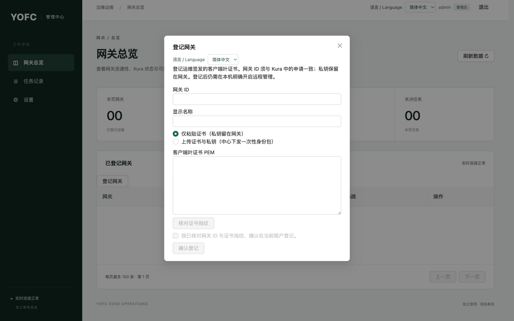

1. 填写 **网关 ID**（如 `gw-001`）与 **显示名称**。
2. 选择 **「上传证书与私钥（中心下发一次性身份包）」**。
3. 粘贴网关证书（`tls/gw-001.pem`）与私钥（`tls/gw-001.key`）全文。
4. 点 **核对证书指纹**，显示 SHA-256 后勾选确认：

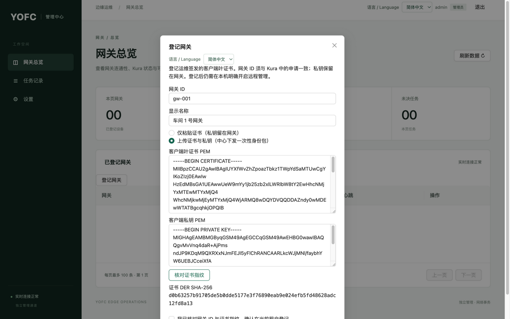

5. 点 **确认登记**。出现**一次性身份包下载**：
   - **网关连接中心地址** 填网关访问中心的地址（格式 `https://<中心IP或主机名>:18444`；本演示用 `https://host.orb.internal:18444`）。
6. 点 **下载身份包（.tar）**，浏览器保存得到 `gw-001-identity-bundle.tar`。

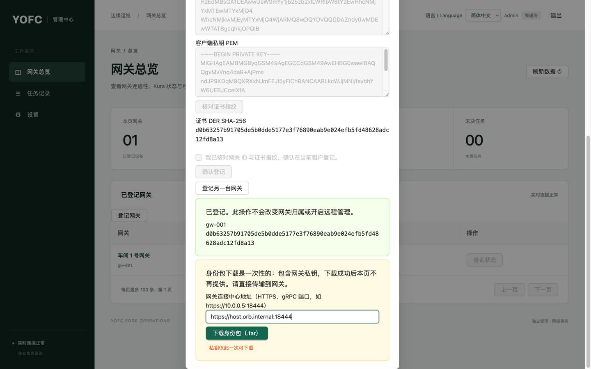

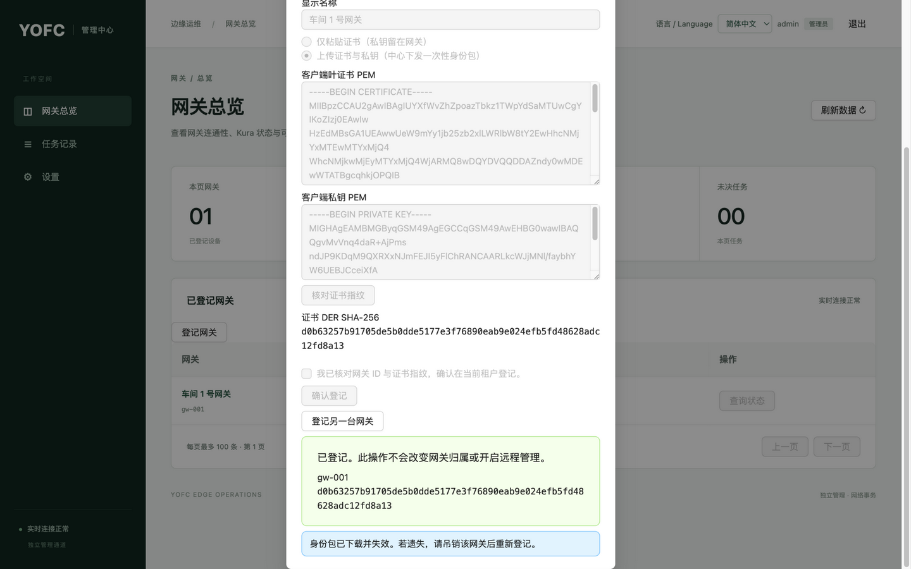

**注意**：包内含网关私钥，**下载即失效**；遗失须删除该网关后重新登记（证书指纹唯一，同证书不能重复登记）。把 `gw-001-identity-bundle.tar` 拷贝到网关（scp/U 盘均可）。

## 5. 网关安装代理并一条命令导入身份

在网关上（本文示例为 Ubuntu 24.04 arm64 虚拟机/物理机）：

```sh
# 安装（含升级）不自动开启远程、不生成密钥；安装后 agent 以本地模式启动
sudo dpkg -i kura-management-agent_0.1.0~manual20261111_arm64.deb
# 停止本地模式，导入身份包（校验 manifest 指纹链与证书/私钥配对）
sudo systemctl stop kura-management-agent.service
sudo kura-agent-setup import-bundle /tmp/gw-001-identity-bundle.tar
```

- **入口是 `kura-agent-setup`**（`/usr/lib/kura-management-agent/setup.py` 无执行位，直接执行会 Permission denied）。
- 失败即拒绝并保留现场，无 force 选项；`Existing or interrupted identity` 表示网关已有身份，须走转移或 purge 重装。

## 6. 开启远程通道并激活

**远程开关是持久决策，不看 env**：装包时本地模式启动已写入 `remote-management.json`（enabled=false），之后修改 `AGENT_REMOTE_ENABLED=1` **不会生效**。用本地控制 socket 显式开启（脚本 `remote-enable-uds.py` 随部署材料提供）：

```sh
sudo kura-agent-setup activate                       # 启动 agent（本地模式，控制 socket 就绪）
sudo python3 remote-enable-uds.py                    # remote.status 取 revision → remote.set-enabled
sleep 5
journalctl -u kura-management-agent --no-pager -n 10 | grep 'control connected'
# 出现 "control connected epoch=…" 即已连上中心（mTLS）
```

`remote-enable-uds.py` 原理：通过 `/run/kura-management-agent/control.sock` 调 `remote.status` 取当前 revision，再调 `remote.set-enabled {expectedRevision, enabled:true}`，热生效无需重启。

## 7. 在线验证

中心总览约 5 秒内显示 **在线**（真实心跳）：

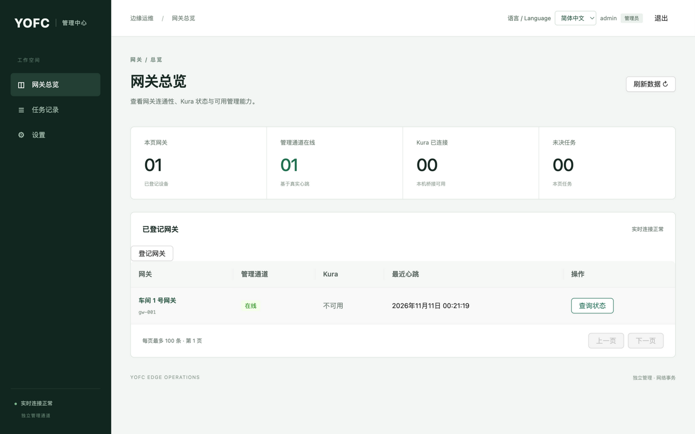

点该行 **查询状态**，再打开 **任务记录**，应看到 `Agent 状态` 任务 **已完成**：

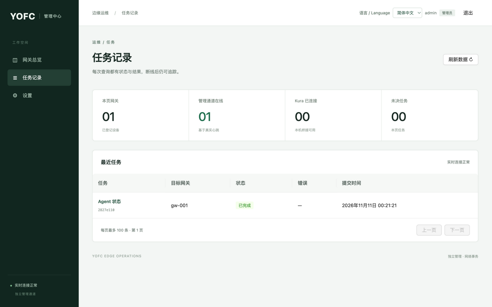

到这里：中心部署 → 管理员接管 → 网关登记 → 身份包导入 → 在线，全流程完成。

## 8. 日常运维：客户端证书轮换

证书到期或泄露时（不换 endpoint、不换代次）：

1. 中心网关详情抽屉 → **轮换客户端证书** → 粘贴新证书与私钥 → 核对指纹 → 确认。中心立即登记新指纹并重置该网关连接（旧证书连接被断开属预期）。
2. 下载一次性 `rotation-bundle.tar`，传到网关执行：

```sh
sudo systemctl stop kura-management-agent.service
sudo kura-agent-setup rotate-bundle /tmp/gw-001-rotation-bundle.tar --operator <操作者>
sudo kura-agent-setup activate
```

agent 校验包内旧指纹与已装证书一致后才轮换；旧证书/私钥备份在 `/var/lib/kura-management-agent/certificate-rotations/N/`。轮换后 agent 以新证书重连，总览恢复在线。

## 9. 可选：CSR 模式（私钥永不出网关）

更高安全要求时，网关本地生成密钥，中心只见 CSR 签出的证书：

```sh
# 网关：停止本地服务后生成密钥 + CSR
sudo systemctl stop kura-management-agent.service
sudo kura-agent-setup create-certificate-request --gateway gw-002 /tmp/gw-002.csr
# 管理员：把 CSR 交给 CA 签发得到证书；中心「登记网关」选「仅粘贴证书（私钥留在网关）」登记
# 网关：激活绑定
sudo kura-agent-setup activate-pending-certificate \
  --endpoint https://<中心IP>:18444 --ca ca.pem --cert gw-002.pem
```

同一时间仅一个待定请求；待绑定密钥在 `/var/lib/kura-management-agent/certificate-requests/`（0700/0600）。

## 10. 排障速查

| 症状 | 处理 |
| --- | --- |
| compose up 后 18443 不可达 | 端口被旧实例/虚拟机转发占用；`lsof -i :18443` 排查后 `docker compose up -d` |
| 登录后无 ⚙ 设置入口 | 仅管理员可见；用 admin 或 admin 角色账号 |
| 登记报 CONFLICT | 同一证书指纹已登记过（指纹唯一）；换证书或先删除旧网关记录 |
| 身份包下载 404 | 一次性 token 已失效（已下载/重新轮换/吊销）；重新登记生成新包 |
| `sudo /usr/lib/kura-management-agent/setup.py …` Permission denied | 入口是 `kura-agent-setup` wrapper；setup.py 无执行位（设计如此） |
| import-bundle 报指纹不符 | 包损坏或发错网关；重新在中心登记下载 |
| `Existing or interrupted identity` | 网关已有身份：`apt purge kura-management-agent` 重装，或走转移流程 |
| env 改 `AGENT_REMOTE_ENABLED=1` 不连中心 | 远程开关是持久决策：用 §6 的 UDS 脚本开启 |
| 中心显示离线 | 确认 `control connected` 日志、中心地址端口（18444）、`AGENT_GATEWAY_ID` 与登记一致、同机无两个 agent 进程 |
| 任务长时间 QUEUED/UNKNOWN | 任务记录页查看；UNKNOWN 只按原命令核定，不自动重试 |
| 设置页上传 TLS 后未生效 | 成对证书进入暂存区，`docker compose restart console` 后激活完整版本；设置页显示当前指纹。已存在的旧式单文件暂存需保留并核对处理 |
| 原任务显示 UNKNOWN | 按原编号查询回执并核定，保持不重发。密钥轮换会等待正在提交的存储操作，不再主动重置任务流 |

---

附：本手册截图摄于 2026-11-11 从零部署的真实实例（macOS Docker Compose 中心 + OrbStack Ubuntu 24.04 arm64 网关 VM，中心 `yofc-management-console`，代理 `kura-management-agent 0.1.0~manual20261111`）。演示口令与测试身份在截图后已按约定清理或替换；重做时请使用你自己的强口令。方案 A 合同见 `docs/provisioning-ui-design-v1.md`。
